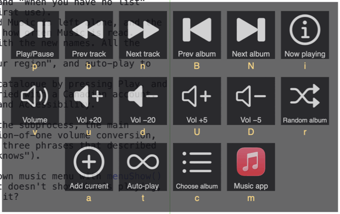

* hs_appleMusic-gt

Control Apple Music from the keyboard, and play albums from a list of your own.

- Play and pause, skip a track or a whole album, and change the volume, from a menu opened with
  one key.
- See what is playing, with a link to the album on Apple Music, copied so you can paste it.
- Keep a list of the albums you want to listen to, and play one you choose, or one at random.
  The list can hold albums you do not have in your library: they are played from the Apple Music
  catalogue.
- Turn on auto-play, and when an album ends, another one from your list starts.

* Installing

The Spoon requires [[https://github.com/dmgerman/hammer2spoons/tree/main/Spoons/hs_menu-gt.spoon2][hs_menu-gt]], which displays its menu. Load it first:

#+begin_src js
hs.spoons.use("hs_menu-gt", { source: "dmgerman/hammer2spoons" })
hs.spoons.use("hs_appleMusic-gt", {
    source: "dmgerman/hammer2spoons",
    start: true,
    hotkeys: { menuShow: [["cmd", "ctrl", "alt"], "m"] }
})
#+end_src

⌃⌥⌘M then opens the music menu. Without hs_menu-gt, =start()= stops with a message that names it.

The first time you play an album, the example list of albums is copied to your configuration
directory; see /The album list/.

* The music menu

#+ATTR_HTML: :alt The music menu: sixteen options for playback, volume and albums, each with an icon and the letter that selects it

Each option has a letter beneath it. Press the letter to select the option. The menu accepts
keyboard input only; it does not respond to the mouse.

| Letter | Option       | Does                                                        |
|--------+--------------+-------------------------------------------------------------|
| p      | Play/Pause   | Play or pause                                               |
| b / n  | Prev / Next track | Go back or forward a track                             |
| B / N  | Prev / Next album | Go back or forward to the start of an album            |
| i      | Now playing  | Show the track playing, and copy it with the album's link   |
| v      | Volume       | Show Music's volume                                         |
| u / d  | Vol +20 / −20 | Raise or lower Music's volume by 20                        |
| U / D  | Vol +5 / −5  | Raise or lower Music's volume by 5                          |
| r      | Random album | Play an album from your list, chosen at random              |
| a      | Add current  | Add the album playing to your list                          |
| t      | Auto-play    | Turn auto-play on or off                                    |
| c      | Choose album | Choose an album from your list and play it                  |
| m      | Music app    | Bring Music forward, starting it if needed                  |

The menu stays open after the track and volume options, so you can select them several times in
a row. The others close it.

The menu is also =menu=, so a menu of your own can include it, or add your own options to it.
See [[https://github.com/dmgerman/hammer2spoons/tree/main/Spoons/hs_menu-gt.spoon2][hs_menu-gt]] for how menus work.

* The album list

Your list of albums is a text file, =albums.txt= in your Hammerspoon 2 configuration directory,
unless =config.albumListPath= names another. It has one album per line, in either of two forms:

#+begin_src text
# An Apple Music address. The comment after it is the name shown in the chooser.
https://music.apple.com/ca/album/kid-a/1097862870 # Radiohead — Kid A

# A band and an album, separated by |, searched for each time the album is played.
Radiohead|Kid A
#+end_src

Everything from a =#= to the end of a line is a comment. Blank lines, and lines that are neither
an address nor contain a =|=, are skipped.

** Use addresses

An address names one album exactly, and plays it without a search. A =Band|Album= line is
searched for in the Apple Music catalogue each time, and the search is not always right:

- It may not find the album at all. A search for "Radiohead Pablo Honey" finds no Radiohead
  album.
- It may find no album whose name matches exactly, and then the first result is played, with an
  alert naming it.
- It may find several albums of the same name, such as three releases of Miles Davis's /Kind of
  Blue/, and play the first.

So write each album as an address. There are two ways to get one:

1. *Add the album that is playing,* with the menu's /Add current/ option or =currentAlbumAdd()=.
   It adds the album's address, with its name as a comment. It finds the album by the playing
   track's name, artist and length, so a remaster is not confused with the original.
2. *Copy the album's link.* In Music, open the album's page, click =⋯= and choose /Share/ →
   /Copy Link/, then paste the link into the list as a line of its own. A link copied from the
   album's page on =music.apple.com= in a browser works as well. Add a comment with the album's
   name, for the chooser.

** When you have no list

The Spoon includes an example list, [[file:albums.txt][albums.txt]], with every Radiohead studio
album and albums by Miles Davis and Pink Floyd. When there is no =albums.txt= in your
configuration directory, the example is copied there the first time an album is chosen, and an
alert says so. From then on it is your list: edit it, or add to it.

* Auto-play

With auto-play on, the Spoon checks every five minutes whether Music has stopped, and if it has,
plays an album from your list chosen at random. A paused Music is left alone. Turn it on with the
menu's /Auto-play/ option, or =autoPlayToggle()=.

Hammerspoon 2 receives no notification when an album ends, so the Spoon reads Music's state on a
timer, and there can be up to =config.autoPlayInterval= seconds of silence between albums. A
smaller value shortens the silence, and reads Music's state more often.

* Functions

Every option of the menu calls one of these, and you can call them from your own configuration.

** Playback

| Function              | Does                                                        |
|-----------------------+-------------------------------------------------------------|
| =playPauseToggle()=   | Play or pause.                                              |
| =play()=              | Start or resume playing.                                    |
| =playbackStop()=      | Stop. Playing after a stop restarts the album.              |
| =trackNext()=, =trackPrevious()= | Skip a track forward or back.                    |
| =albumNext()=, =albumPrevious()= | Skip to the next album, or back to the start of the previous one. |
| =playerState()=       | ="playing"=, ="paused"=, ="stopped"= or ="not running"=.    |
| =isPlaying()=, =isRunning()= | Whether Music is playing, and whether it is running. |
| =focus()=             | Bring Music forward, starting it if needed.                 |

Music has no command for skipping an album, so =albumNext()= and =albumPrevious()= skip one track
at a time until the album changes, up to =config.maxAlbumSkipAttempts= tracks.

** What is playing

| Function              | Does                                                        |
|-----------------------+-------------------------------------------------------------|
| =currentTrack()=      | ={name, artist, album, duration}= of the track playing, or null. =duration= is in seconds. |
| =currentArtist()=, =currentAlbum()= | One of those fields.                           |
| =currentTrackShow()=  | Show the track and its album's link, and copy them.         |
| =currentTrackText()=  | A promise of the same text.                                 |
| =currentAlbumURL()=   | A promise of the Apple Music address of the album playing, or of null. |

Music's scripting does not report an album's Apple Music address, so the Spoon finds it in the
catalogue by the playing track's name, artist and length. When those do not identify one album, it returns nothing
rather than a guess.

** Volume

Music has a volume of its own, separate from the volume of the output device. Both run from 0
to 100.

| Function                    | Does                                                  |
|-----------------------------+-------------------------------------------------------|
| =volumeGet()=               | Music's volume, or null when Music is not running.    |
| =volumeShow()=              | Show Music's volume.                                  |
| =volumeSet(level)=          | Set Music's volume.                                   |
| =volumeAdjust(delta)=       | Change Music's volume by =delta=, which may be negative, and show it. |
| =systemVolume()=            | The output device's volume, or null when it has none. |
| =systemVolumeSet(percent)=  | Set the output device's volume, and show the result.  |

Some output devices, HDMI among them, have no volume that can be set. =systemVolumeSet()= then
says so.

** Albums

| Function                     | Does                                                  |
|------------------------------+-------------------------------------------------------|
| =albumRandomPlay()=          | Play an album from your list, chosen at random.       |
| =albumChoose()=              | Choose an album from your list, and play it.          |
| =currentAlbumAdd()=          | Add the album playing to your list.                   |
| =albumPlay(band, album)=     | Search for an album and play it. See /Use addresses/. |
| =albumsRead()=               | Your list, as entries ={kind: "url", url, label}= or ={kind: "name", band, album}=. |
| =albumRandomPick()=          | One entry of your list, chosen at random, without playing it. |
| =entryPlay(entry)=           | Play one entry of the list.                           |
| =albumResolve(band, album)=  | A promise of ={name, artist, url}= for an album found by searching, or of null. |
| =albumURLResolve(track)=     | A promise of the address of a track's album, as =currentAlbumURL()= finds it. |

=albumRandomPlay()=, =albumChoose()=, =currentAlbumAdd()=, =albumsRead()= and =albumRandomPick()= take the path of another list as an optional argument.

** Auto-play

=autoPlayStart()=, =autoPlayStop()=, =autoPlayToggle()= and =autoPlayIsEnabled()=.

** The menu and keys

=menuShow()= opens the music menu, and =menu= is its options. =bindHotkeys({ menuShow: [mods,
key] })= binds a key to it; =hs.spoons.use()= calls it with its =hotkeys= option.

* Configuration

| Setting                  | Default                     | Meaning                                        |
|--------------------------+-----------------------------+------------------------------------------------|
| =albumListPath=          | =albums.txt= in your configuration directory | Your album list.               |
| =storefront=             | your region                 | The Apple Music store searched, as a country code such as ="us"=. |
| =trackFormat=            | ="{name} - {artist} [{album}]"= | How a track is shown. ={name}=, ={artist}=, ={album}= and ={url}= are replaced. |
| =trackURLFormat=         | =trackFormat=, then the link | Used instead of =trackFormat= when the album's link was found. |
| =alertDuration=          | =3=                         | Seconds a message stays on screen.             |
| =autoPlayInterval=       | =300=                       | Seconds between auto-play's checks.            |
| =maxAlbumSkipAttempts=   | =20=                        | Tracks skipped before giving up on reaching another album. |
| =albumSkipInterval=      | =0.3=                       | Seconds between those skips.                   |
| =durationTolerance=      | =2=                         | Seconds two tracks' lengths may differ and still be the same recording. |
| =playButtonTitle=        | ="Play"=                    | The title of the Play button on an album's page in Music. |
| =playButtonPollInterval= | =0.4=                       | Seconds between looks for that button.         |
| =playButtonTimeout=      | =10=                        | Seconds before giving up on it.                |
| =searchLimit=            | =25=                        | Search results considered.                     |

The store is the country of your system's region, such as =ca= for English (Canada). Set
=storefront= when your Apple Music account belongs to another country.

* Notes

- *Albums are played from the Apple Music catalogue,* even ones in your library. Music's
  scripting can play only what is in the library, so the Spoon opens the album's page in Music
  and presses its Play button. If a future version of Music renames that button, set =playButtonTitle=.
- *The addresses in the example list are for the Canadian store* (=/ca/=). An address identifies
  the album by its number, and Music should open the same album in your own store, but this has
  only been tried with a Canadian account.

* Requirements

- Apple Music, with a subscription to play albums that are not in your library.
- [[https://github.com/dmgerman/hammer2spoons/tree/main/Spoons/hs_menu-gt.spoon2][hs_menu-gt]], loaded before this Spoon.
- The Accessibility permission, which pressing Play on an album's page requires.
