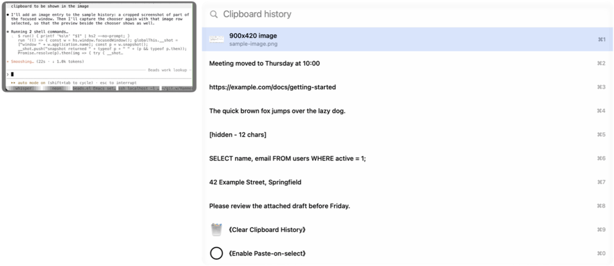

* hs_clipboard-gt

hs_clipboard-gt keeps a history of what is copied to the clipboard. macOS keeps only the last
item copied, so copying something new loses whatever was copied before. With this Spoon, every
text and image copied is added to a history, and one key opens a chooser of that history.
Selecting an entry in the chooser copies it to the clipboard again.

Its main features are these:

- *A history of copied text and images,* newest first, kept across a restart of Hammerspoon 2.
- *Search.* Typing in the chooser narrows the list to the entries that contain the text typed.
- *Paste on select.* When it is turned on, selecting an entry also pastes it into the window
  that had the focus.
- *Passwords kept off disk.* An entry that looks like a password is masked in the chooser, and
  is never written to disk.
- *A preview of a copied image,* drawn beside the chooser at a size that can be read.
- *Several entries pasted at once,* in the order they were copied.
- *A clipboard menu,* opened with one key, in which a letter selects each option.

The chooser, with a copied image selected and drawn beside it, and one text entry masked as a
password:

#+ATTR_HTML: :alt The clipboard history chooser listing a copied image, selected and drawn larger to the chooser's left, followed by seven text entries, one of them masked as hidden - 12 chars, and the rows that clear the history and turn on paste on select

* Installing

This Spoon requires two other Spoons from this repository, which must be loaded before it:

- [[https://github.com/dmgerman/hammer2spoons/tree/main/Spoons/hs_interactive-gt.spoon2][hs_interactive-gt]] is told when the history's chooser opens and closes. Other Spoons that
  bind keys, such as hs_menu-gt, then release those keys while the chooser is open, so that the
  text typed reaches the chooser.
- [[https://github.com/dmgerman/hammer2spoons/tree/main/Spoons/hs_menu-gt.spoon2][hs_menu-gt]] displays the clipboard menu.

The following configuration installs the three Spoons. It binds ⌃⌥⌘V to the history, and
⌃⌥⌘⇧V to the clipboard menu:

#+begin_src js
hs.spoons.use("hs_interactive-gt", { source: "dmgerman/hammer2spoons" })
hs.spoons.use("hs_menu-gt", { source: "dmgerman/hammer2spoons" })
hs.spoons.use("hs_clipboard-gt", {
    source: "dmgerman/hammer2spoons",
    start: true,
    hotkeys: {
        historyShow: [["cmd", "ctrl", "alt"], "v"],
        menuShow:    [["cmd", "ctrl", "alt", "shift"], "v"]
    }
})
#+end_src

When either required Spoon is not loaded, =start()= throws an error that names the missing Spoon.

A 📋 item also appears in the menu bar. Clicking it opens or closes the history.

* The history

Every text and image copied to the clipboard is added to the top of the history, so the newest
entry is first. Copying text that is already in the history moves that entry to the top instead
of adding a second one.

The history holds at most 100 text entries and 10 image entries. The two limits are counted
separately, so that copying a run of screenshots does not remove text entries. When a limit is
reached, the oldest entry of that kind is removed, and an image's file is deleted with it.

An entry longer than 4,990 characters is shortened when it is stored, at the last blank line
that fits, or at the limit when there is none.

Some applications mark what they copy as private or temporary, such as a password manager
copying a password. Such a copy is not added to the history. The list of these markers comes
from [[http://nspasteboard.org][nspasteboard.org]].

* The chooser

The chooser lists the history, newest first. A text entry shows its first 200 characters, and an
image entry shows the image and its size.

Typing narrows the list to the entries whose shown text contains what is typed. Text beyond the
first 200 characters of an entry is not searched.

Selecting an entry copies it to the clipboard. When paste on select is turned on, the entry is
also pasted into the window that had the focus before the chooser opened.

Two rows at the end of the list act on the history itself:

| Row                                | Action                                                     |
|------------------------------------+------------------------------------------------------------|
| 《Clear Clipboard History》        | Empties the history and the clipboard.                     |
| 《Enable/Disable Paste-on-select》 | Turns paste on select on or off. The setting is kept with the history. |

** Acting on one entry

Right-clicking an entry opens a menu of actions on that entry:

| Action                              | Effect                                                      |
|-------------------------------------+-------------------------------------------------------------|
| Paste all up to here, tab separated | Types every text entry from this one up to the newest, oldest first, separated by tabs. |
| Paste all up to here, one per line  | The same, with one entry per line.                          |
| Delete entry                        | Removes the entry from the history.                         |
| Move entry to top                   | Moves the entry to the top of the history.                  |
| Move entry up, Move entry down      | Moves the entry one place up or down.                       |
| Invert order above                  | Reverses the order of the entries from this one up to the newest. |

/Paste all up to here/ types entries that were copied one after another back in the order they
were copied, such as several fields copied from one document into another. Image entries are
skipped, because an image cannot be typed.

The right-click menu requires a build of Hammerspoon 2 that includes upstream pull request #377,
merged on 2026-11-07.

** The image preview

The image of an image entry's row is only a few points high. When an image entry is selected,
this Spoon also draws the image beside the chooser, at up to half the screen's height. A smaller
image is drawn at its own size, not enlarged.

* Passwords

An entry that looks like a password is masked in the chooser as =[hidden - 16 chars]=, and is
never written to disk. It stays in the history until Hammerspoon 2 restarts, so that it can still
be pasted.

While the chooser is open, ⌘R reveals the selected masked entry, and ⇧⌘R reveals every masked
entry. Pressing the same key again masks them, and closing the chooser masks every entry again.

An entry is masked only when it passes three tests:

1. *It has none of the forms that are never passwords,* such as an address, a file name, a date,
   a number, or a hexadecimal hash.
2. *It is shaped like a password:* at least 8 characters, no spaces, and at least two of lower
   case letters, capital letters, digits and symbols.
3. *It looks random:* its Shannon entropy is at least 3.5 bits per character.

The line breaks at the start and the end of an entry are left out of these tests, so a password
copied with a line break after it, as from a terminal, is masked. An entry with more line breaks
than =passwordMaxNewlines=, which is 1 by default, is never masked, and neither is an entry with
a line break inside it.

Only text entries are tested. An image is always written to disk, even an image of a password,
such as a screenshot of one.

=passwordLike(text)= reports whether a text would be masked, which helps when adjusting the
settings below. Setting =passwordsHide= to false masks nothing and writes every entry to disk.

** A different password test

=config.passwordTest= replaces the three tests above with a function of the configuration. The
function receives the text and this Spoon's own test, and returns whether the text is a password.
The function is then used everywhere a text is tested: for masking it in the chooser, for leaving
it out of the file, and for the alert after a copy.

This test masks the texts that this Spoon's own test masks, and also every text that begins with
=sk-=, the form of some services' secret keys:

#+begin_src js
hs.spoons["hs_clipboard-gt"].config.passwordTest = (text, defaultTest) =>
    defaultTest(text) || text.startsWith("sk-")
#+end_src

A function that throws is reported in the console, and the text it was given is then treated as
a password. An error in the function therefore keeps an entry off disk, rather than writing it.

* The clipboard menu

=menuShow()= displays the clipboard menu. Each option has a letter beneath it, and pressing that
letter selects the option:

| Letter | Option          | Action                                                     |
|--------+-----------------+------------------------------------------------------------|
| v      | History         | Opens the history's chooser.                               |
| s      | Paste-on-select | Turns paste on select on or off.                           |
| d      | Drop last       | Removes the newest entry, for something copied by mistake. |
| c      | Clear all       | Empties the history and the clipboard.                     |

/History/ closes the menu, because the chooser takes the keyboard. The other options keep the
menu open.

The menu is exported as =menu=. A menu defined in the configuration can include it as a
submenu, with =children: hs.spoons["hs_clipboard-gt"].menu=. The readme of
[[https://github.com/dmgerman/hammer2spoons/tree/main/Spoons/hs_menu-gt.spoon2][hs_menu-gt]]
describes how menus are defined.

* Functions

This Spoon exports the following functions. A function that changes the history returns this
Spoon, unless its description names another value. A /row/ is an entry's position in the
history, counting from 0 at the newest entry.

| Function                           | Action                                                     |
|------------------------------------+------------------------------------------------------------|
| =historyShow()=                    | Opens the history's chooser.                               |
| =historyHide()=                    | Closes the history's chooser.                              |
| =historyToggle()=                  | Opens the chooser, or closes it when it is open.           |
| =historyClear()=                   | Empties the history and the clipboard.                     |
| =historyLastDelete()=              | Removes the newest entry.                                  |
| =historyEntries()=                 | Returns the history as an array of strings, newest first. A password-like entry is included unmasked, and an image entry is described by its size and its file. |
| =entryDelete(row)=                 | Removes one entry.                                         |
| =entryToTopMove(row)=              | Moves one entry to the top.                                |
| =entryUpMove(row)=, =entryDownMove(row)= | Moves one entry one place up or down.                |
| =entriesInvert(row)=               | Reverses the order of the entries from =row= up to the newest. |
| =entriesPaste(row, delimiter)=     | Types every text entry from =row= up to the newest, oldest first, each followed by =delimiter=, into the window that had the focus. |
| =pasteOnSelectToggle()=            | Turns paste on select on or off, and returns whether it is now on. |
| =pasteOnSelectIsEnabled()=         | Returns whether paste on select is on.                     |
| =passwordLike(text)=               | Returns whether a text would be masked.                    |
| =currentPasswordRevealToggle()=    | Reveals or masks the selected entry. ⌘R calls it while the chooser is open. |
| =passwordsRevealToggle()=          | Reveals or masks every masked entry. ⇧⌘R calls it while the chooser is open. |
| =menuShow()=                       | Displays the clipboard menu.                               |
| =bindHotkeys(mapping)=             | Binds keys to =historyShow=, =historyToggle= or =menuShow=, as /Installing/ shows. A second call releases the keys of the first, and any other name is an error. |

=start()= checks that hs_interactive-gt and hs_menu-gt are loaded, reads the history from disk,
removes from the file any password-like entry left in it, starts watching the clipboard, and
adds the menu bar item. =stop()= undoes all of this, and leaves the history on disk.

* Configuration

The settings are the fields of =config=, and are set before =start()=:

#+begin_src js
hs.spoons["hs_clipboard-gt"].config.historySize = 200
#+end_src

The =config= option of =hs.spoons.use()= sets them too, as the Hammerspoon 2 Spoons guide
describes: each setting is also a property of this Spoon's object, which reads and writes
=config=.

#+begin_src js
hs.spoons.use("hs_clipboard-gt", { config: { historySize: 200 } })
#+end_src

| Setting                    | Default                   | Meaning                                         |
|----------------------------+---------------------------+-------------------------------------------------|
| =historySize=              | =100=                     | The number of text entries kept.                |
| =imageHistorySize=         | =10=                      | The number of image entries kept.               |
| =maxEntrySize=             | =4990=                    | The number of characters kept of one entry.     |
| =displayMaxLength=         | =200=                     | The number of characters of an entry shown, and searched, in the chooser. |
| =deduplicate=              | =true=                    | Whether copying an entry that is already in the history moves it to the top instead of adding it again. |
| =copiedAlert=              | =true=                    | Whether an alert reports each copy.             |
| =alertDuration=            | =1=                       | Seconds the alert is displayed.                 |
| =honorIgnoredIdentifiers=  | =true=                    | Whether copies marked as private or temporary are left out of the history. |
| =ignoredIdentifiers=       | seven markers             | The markers that =honorIgnoredIdentifiers= checks. |
| =passwordsHide=            | =true=                    | Whether password-like entries are masked and kept off disk. |
| =passwordTest=             | =null=                    | A function =(text, defaultTest)= that replaces this Spoon's test for passwords. See /A different password test/. |
| =passwordEntropyThreshold= | =3.5=                     | The entropy, in bits per character, at which an entry looks random. |
| =passwordMinLength=        | =8=                       | The shortest entry that can be masked.          |
| =passwordMaxNewlines=      | =1=                       | An entry with more line breaks than this is never masked. |
| =revealCurrentKey=         | ⌘R                        | The key that reveals the selected entry, as ={mods, key}=. |
| =revealAllKey=             | ⇧⌘R                       | The key that reveals every masked entry.        |
| =pasteDelay=               | =0.2=                     | Seconds between closing the chooser and pasting, so that the paste reaches the window that regains the focus. |
| =showPreview=              | =true=                    | Whether a selected image is drawn beside the chooser. |
| =previewHeightRatio=       | =0.5=                     | The largest height of that image, as a fraction of the screen's height. |
| =previewGap=               | =12=                      | Points between the image and the chooser.       |
| =previewPollSeconds=       | =0.15=                    | Seconds between readings of the selected row.   |
| =watchInterval=            | =0.8=                     | Seconds between readings of the clipboard.      |
| =menubarShow=              | =true=                    | Whether the menu bar item is shown.             |
| =menubarTitle=             | 📋                        | The menu bar item's title.                      |
| =clipboardDir=             | =clipboard/= in the configuration directory | The directory of the history and the image files. |
| =historyFile=              | =clipboard/clipboard.json= in the configuration directory | The file of the history. |

=watchInterval= sets the interval of Hammerspoon 2's clipboard watcher, which every Spoon shares.
Hammerspoon 2 reads the interval only when the watcher starts, which happens when the first
Spoon begins to watch the clipboard. That Spoon's value is then used for all of them. A value
set while another Spoon is watching takes effect only after every Spoon has stopped watching.

=previewPollSeconds= exists because =hs.chooser= reports no change of the selected row. While the
chooser is open, this Spoon reads the selected row at that interval, and a smaller value makes
the preview follow the selection sooner.

* Files

The history is the JSON file =historyFile=. It holds the paste on select setting and the
entries, newest first, and is rewritten whenever the history changes. It is also rewritten once
by =start()=, so that a password-like entry left in it by an earlier version is removed even
when nothing is copied afterwards.

Each image is a PNG file in =clipboardDir=, named after the time it was copied, such as
=20261115T165612.png=. A second image copied in the same second is given a number, such as
=20261115T165612-2.png=. The directory holds exactly the images that the history refers to.

* Credits

This Spoon is a port to Hammerspoon 2 of /ClipboardTool/, by Alfred Schilken, released under the
MIT licence. ClipboardTool was itself derived from /TextClipboardHistory/ and from code by VFS and
asmagill. The detection of passwords was added to a copy of ClipboardTool before the port.

These are the differences from ClipboardTool:

1. Images are stored as files, with their own limit, rather than encoded in the list of entries.
2. The history is a JSON file in the configuration directory, rather than a setting of the
   application.
3. An entry longer than =maxEntrySize= is shortened without asking, because Hammerspoon 2 has no
   dialog module that ClipboardTool's question could be ported to.
4. The right-click menu is in English. ClipboardTool's was in German.

* Requirements

This Spoon requires the following:

- hs_interactive-gt and hs_menu-gt, loaded before this Spoon.
- A build of Hammerspoon 2 that includes upstream pull request #377, for the right-click menu.

* License

This Spoon is released under the MIT License. Copyright (c) 2026 Daniel M German. The full text
is in the file =LICENSE= at the top of the [[https://github.com/dmgerman/hammer2spoons][hammer2spoons]] repository.

It is a port of /ClipboardTool/, which is Copyright (c) Alfred Schilken and released under the MIT
License; its notice is kept here, as that licence requires.
