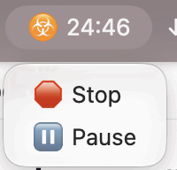

* hs_countdown-gt

hs_countdown-gt runs a countdown timer whose progress stays in view while the user works. A
countdown, such as a 25 minute work session, is started with one key. A thin bar along the bottom
edge of every screen then fills in as the time passes, and the menu bar shows the time left. When
the time is up, a sound plays and a dialog appears.

Its main features are these:

- *A progress bar on every screen,* along the bottom edge, which changes colour from red to green
  as the countdown advances. It does not cover anything that can be clicked.
- *The time left in the menu bar,* counting down in minutes and seconds.
- *Warnings as the end approaches,* shown at 16, 8, 4, 2 and 1 minutes left.
- *A countdown to a time of day,* such as 14:30, as well as one for a number of minutes.
- *Pausing,* so that a countdown resumes where it stopped.
- *A countdown menu,* opened with one key, in which a letter selects each option.

The menu bar item while a countdown runs, with its menu open:

#+ATTR_HTML: :alt The countdown's menu bar item showing 24:46 left, with its menu open on the entries Stop and Pause

The bottom edge of a screen during a countdown that is 40% through: the passed part of the bar is
green, and the part still to pass is red.

#+ATTR_HTML: :alt The bottom edge of a screen, with a thin progress bar green on its left two fifths and red on the rest

* Installing

This Spoon requires two other Spoons from this repository, which must be loaded before it:

- [[https://github.com/dmgerman/hammer2spoons/tree/main/Spoons/hs_interactive-gt.spoon2][hs_interactive-gt]] asks the user for the length of a countdown, when it is started from
  /Start for…/.
- [[https://github.com/dmgerman/hammer2spoons/tree/main/Spoons/hs_menu-gt.spoon2][hs_menu-gt]] displays the countdown menu.

The following configuration installs the three Spoons, and binds ⌃⌥⌘T to the countdown menu:

#+begin_src js
hs.spoons.use("hs_interactive-gt", { source: "dmgerman/hammer2spoons" })
hs.spoons.use("hs_menu-gt", { source: "dmgerman/hammer2spoons" })
hs.spoons.use("hs_countdown-gt", {
    source: "dmgerman/hammer2spoons",
    start: true,
    hotkeys: { menuShow: [["cmd", "ctrl", "alt"], "t"] }
})
#+end_src

When either required Spoon is not loaded, =start()= throws an error that names the missing Spoon.

* The countdown menu

=menuShow()= displays the countdown menu. Each option has a letter beneath it, and pressing that
letter selects the option:

| Letter | Option       | Action                                                          |
|--------+--------------+-----------------------------------------------------------------|
| t      | Start        | Starts a countdown of the default length, 25 minutes.           |
| f      | Start for…   | Asks for a length, and starts a countdown of that length.       |
| p      | Pause/Resume | Pauses the countdown, or resumes a paused one.                  |
| c      | Cancel       | Cancels the countdown.                                          |

The menu closes after each option. It is exported as =menu=, so a menu defined in the
configuration can include it as a submenu, with =children: hs.spoons["hs_countdown-gt"].menu=.

The menu bar item offers the same actions when it is clicked: /Start/ and /Start for…/ while no
countdown runs, and /Pause/ or /Resume/ and /Stop/ while one runs.

* Starting a countdown

A countdown has a length in whole minutes, of at least 1. Only one countdown runs at a time, so
starting another while one runs is refused, with a message.

/Start for…/, or =countdownPromptedStart()=, asks for the length in a dialog. The answer is either a number of
minutes, such as =45=, or a time of day, such as =14:30=, at which the countdown ends. An answer
that is neither is reported in the dialog, which asks again with that answer filled in, to be
corrected. A number of minutes is rounded to a whole number, and one that rounds to 0, such as
=0.4=, is reported in the same way. Cancel closes the dialog without starting a countdown.

The length used by /Start/ is =config.defaultLenMinutes=. Each countdown started also sets that
length, so /Start/ repeats the last length used. Setting =config.useLastTimerAsDefault= to false
keeps the default length fixed.

** Times of day

A time of day is written in one of these forms:

| Form      | Example   | Meaning                                         |
|-----------+-----------+-------------------------------------------------|
| =hh:mm=   | =14:30=   | A 24-hour clock, with hours from 00 to 23.      |
| =h:mm am= | =9:30 am= | A morning. =12:00 am= is midnight.              |
| =h:mm pm= | =9:30 pm= | An afternoon or evening, so 21:30. =12:00 pm= is noon. |

=am= and =pm= may be written in capitals, and the space before them may be left out. The minutes
are always two digits.

A time earlier than the current time, or the current minute itself, means that time tomorrow, so
at 22:00 a countdown to =7:00= runs for nine hours. A time that is not in one of these forms, such as =24:00=, =13:00 pm= or
=10:30 sharp=, is reported and starts no countdown.

* While a countdown runs

The progress bar runs along the bottom edge of every screen. The part already passed is green,
and the part still to pass is red. The bar does not take clicks, so a click on it reaches the Dock
or the window beneath it. When a display is connected, disconnected or resized, the bars are
rebuilt for the screens there are then.

The menu bar item shows the time left as =mm:ss=, or as =h:mm:ss= for more than an hour.

A warning with the time left appears at each power of two of minutes left: 1, 2, 4, 8, 16, 32 and
so on. A warning appears only for a time shorter than the countdown itself, so a 25 minute
countdown warns at 16, 8, 4, 2 and 1 minutes, and a 4 minute countdown at 2 and 1 minutes.

Pausing stops the countdown, and the time spent paused does not count. A 25 minute countdown
paused for 5 minutes therefore ends 30 minutes after it started.

* When the time is up

When the countdown ends, four things happen:

1. The sound =config.alertSound= plays, and macOS shows a notification. The notification requires
   Hammerspoon 2 to have the Notifications permission.
2. An alert with the countdown's length appears for =config.alertLen= seconds.
3. A dialog appears, which stays until its OK button is clicked, when =config.notify= is true.
4. The window that had the focus is focused again once the dialog is closed.

Setting =alertSound= to null stops both the sound and the notification.

* Functions

This Spoon exports the following functions. A function that acts on the countdown returns this
Spoon.

| Function                                | Action                                                    |
|-----------------------------------------+-----------------------------------------------------------|
| =countdownStart([minutes], [callback])= | Starts a countdown of =minutes=, or of =config.defaultLenMinutes= when it is omitted. |
| =countdownUntilStart(time, [callback])= | Starts a countdown that ends at =time=, a time of day as /Times of day/ describes. |
| =countdownPromptedStart([callback])=    | Asks for a length, as /Starting a countdown/ describes, and returns a promise of this Spoon once the countdown starts or the dialog is cancelled. |
| =pauseToggle()=                         | Pauses the countdown, or resumes a paused one.            |
| =countdownCancel()=                     | Cancels the countdown.                                    |
| =progressSet(progress)=                 | Moves the countdown to a point in its length, from =0.0= to =1.0=. =progressSet(0.9)= on a 25 minute countdown leaves 2.5 minutes. |
| =countdownIsRunning()=                  | Returns whether a countdown is running. A paused countdown is running. |
| =timeLeft()=                            | Returns the seconds left, or 0 when no countdown is running. |
| =menuShow()=                            | Displays the countdown menu.                              |
| =bindHotkeys(mapping)=                  | Binds the key given as ={ menuShow: [modifiers, key] }= to =menuShow()=. A second call releases the key of the first, and any other name is an error. |

Version 4.0.0 renamed five of these functions, so that each name begins with what it acts on.
A configuration written for an earlier version has to use the new names:

| Before 4.0.0   | From 4.0.0               |
|----------------+--------------------------|
| =startFor=     | =countdownStart=         |
| =startUntil=   | =countdownUntilStart=    |
| =startAsk=     | =countdownPromptedStart= |
| =cancel=       | =countdownCancel=        |
| =isRunning=    | =countdownIsRunning=     |

=start()= checks that hs_interactive-gt and hs_menu-gt are loaded, and adds the menu bar item and
the progress bars. =stop()= cancels the countdown, and removes the menu bar item, the progress bars
and the key.

** Following a countdown from code

The start functions take an optional callback, called as =(event, minutes)= at each change of the
countdown. A callback is how code in the configuration acts on a countdown, for example to turn
on a "do not disturb" setting when one starts:

#+begin_src js
hs.spoons["hs_countdown-gt"].countdownStart(25, (event, minutes) => {
    console.log(`countdown ${event}, ${minutes} minutes`)
})
#+end_src

| Event           | =minutes= is                           |
|-----------------+----------------------------------------|
| ="started"=     | 0                                      |
| ="paused"=      | the minutes left                       |
| ="resumed"=     | the minutes left                       |
| ="cancelled"=   | the minutes left                       |
| ="ended"=       | the length of the countdown            |
| ="progressSet"= | the minutes left after =progressSet()= |

A cancelled countdown sends ="cancelled"=, and not ="ended"=. The event names are also the values
of =events=, so =events.end= is ="ended"=. A callback that throws is reported in the console, and
the countdown goes on.

* Configuration

The settings are the fields of =config=:

#+begin_src js
hs.spoons["hs_countdown-gt"].config.defaultLenMinutes = 50
#+end_src

| Setting                 | Default     | Meaning                                                    |
|-------------------------+-------------+------------------------------------------------------------|
| =defaultLenMinutes=     | =25=        | The length of a countdown started without one.             |
| =useLastTimerAsDefault= | =true=      | Whether each countdown started sets =defaultLenMinutes=.   |
| =notify=                | =true=      | Whether a dialog appears when the time is up.              |
| =messageDuration=       | =2=         | Seconds a message, such as an error, is displayed.         |
| =barHeight=             | =5=         | The height of the progress bar, in points.                 |
| =barTransparency=       | =0.8=       | The opacity of the progress bar, from 0.0 to 1.0.          |
| =barColorPassed=        | ="#28CD41"= | The colour of the part already passed.                     |
| =barColorToPass=        | ="#FF3B30"= | The colour of the part still to pass.                      |
| =barSegments=           | =240=       | The number of steps in which the bar fills in.             |
| =alertLen=              | =5=         | Seconds the alert is displayed when the time is up. 0 shows no alert. |
| =alertSound=            | ="Sonar"=   | The name of the macOS sound played when the time is up.    |
| =warningShow=           | =true=      | Whether the warnings appear.                               |
| =warningDuration=       | =3=         | Seconds a warning is displayed.                            |
| =menuBarAlwaysShow=     | =true=      | Whether the menu bar item is shown while no countdown runs. |
| =menuBarIconIdle=       | ⏰          | The menu bar item while no countdown runs.                 |
| =menuBarIconActive=     | ☣️          | The menu bar item while a countdown runs.                  |
| =menuBarIconPause=      | ⏸️          | The menu bar item while a countdown is paused.             |
| =menuBarIconPlay=       | ▶️          | The symbol on the menu's /Resume/ entry.                   |
| =menuBarIconStop=       | 🛑          | The symbol on the menu's /Stop/ entry.                     |

* Credits

This Spoon is a port to Hammerspoon 2 of the Hammerspoon 1 Spoon /hs_countdown_timer/, by
ashfinal, Daniel Marques and Omar El-Domeiri.

* Requirements

This Spoon requires the following:

- hs_interactive-gt and hs_menu-gt, loaded before this Spoon.
- The Notifications permission, for the notification when the time is up. Without it, the sound,
  the alert and the dialog still appear.
