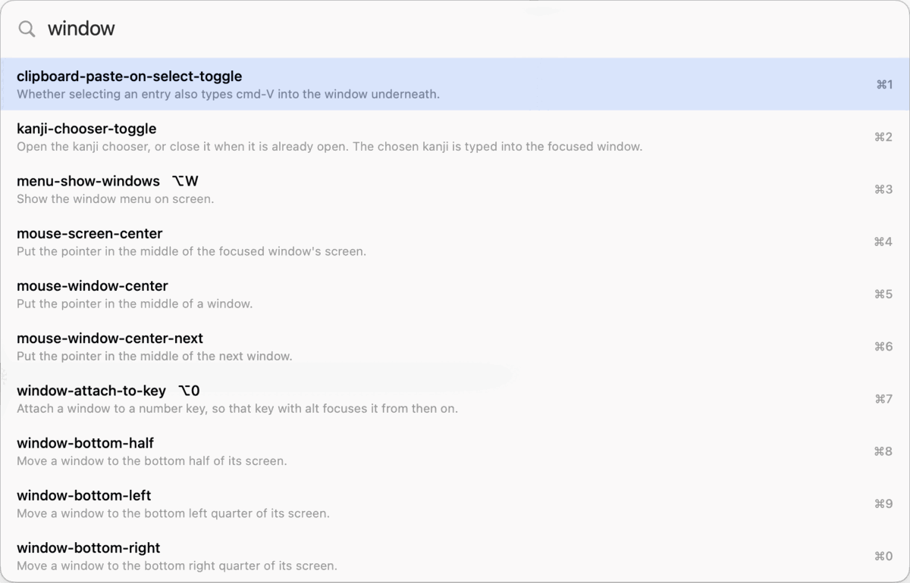

* hs_interactive-gt

Run any action of your Hammerspoon 2 configuration by typing part of its name, and bind keys
to actions by name.

With this Spoon, each action you want to reach becomes a /command/: a function with a name,
such as =window-left-half=, and a one-line description. Then:

- One key opens a chooser listing every command with its description, and the key bound to
  it, if any, written as macOS writes it: =window-maximize   ⌃⌥⌘M=. Typing part of a name
  narrows the list, and choosing a command runs it. So a command you use too seldom to give
  it a key can still be run with a few key presses. The chooser lists the commands you used
  last first.
- A command that needs something to act on asks for it when you run it. A command that acts
  on a window uses the focused window, or shows a chooser of windows when none is focused. A
  command that takes a number shows a dialog for it. Called from your own code, the same
  command takes its arguments directly and asks for nothing.
- Keys are bound to command names, so you can list every binding, ask what a key does, and
  redefine a command without binding its key again.
- One call, =use()=, loads a Spoon, applies its settings, defines its commands and binds
  their keys, in the manner of Emacs's =use-package=.

The command chooser, after typing =window=:

#+ATTR_HTML: :alt The command chooser listing ten commands that match window, each with its description and, for two of them, the key bound to it

The design follows Emacs: a command is declared with an =interactive= specification, as in
Emacs Lisp, and the chooser is the equivalent of =M-x=.

* Installing

The first time this runs, Hammerspoon 2 downloads the Spoon from this repository; after that
it loads the installed copy:

#+begin_src js
hs.spoons.use("hs_interactive-gt", { source: "dmgerman/hammer2spoons" })
const interactive = hs.spoons["hs_interactive-gt"]
#+end_src

To keep a particular version, add =ref= with a tag or a commit. To get a newer version, call
=hs.spoons.update("hs_interactive-gt")=.

No other Spoon in this repository requires this one: whether to use named commands is your
choice. The readme of each of them suggests commands for it, to define in =use()= as shown
under /Loading Spoons/.

* Simple usage

#+begin_src js   :exports both
const interactive = hs.spoons.load("hs_interactive-gt")

interactive.define({
    name: "window-left-half",
    doc:  "Move a window to the left half of its screen.",
    interactive: [
        {
            name: "window",
            reader: interactive.readers.window.auto
        }
    ],
    fn: (win) => {
        const screen = win.screen.frame
        win.frame = new HSRect(screen.x, screen.y, screen.w / 2, screen.h)
    }
})

interactive.keysSet([
    [["cmd", "ctrl", "alt"], "left", "window-left-half"],
    [["cmd", "ctrl", "alt"], "x",    "commands-execute"]     // the chooser
])
#+end_src

The =fn:= parameter is the function that corresponds to this command.

The =interactive:= parameter lists the parameters to gather before the function can be
executed. In this case there is only one. Its =reader:= indicates how to obtain it from
the user: use the current window; if there is no current window, a chooser shows the title
and application of each available window for the user to select one.

There are two ways to invoke this command:

1. Pressing ⌃⌥⌘←, as bound by =keysSet= above, and

2. Pressing ⌃⌥⌘X, which runs =commands-execute=. It shows a chooser of every
   command, from which the user selects =window-left-half=.

In both cases the reader of the interactive parameter is executed, which computes the
window parameter, and the lambda is executed with this parameter.

* Defining commands

** define(spec)

/spec/ takes five fields. Only /name/ and /fn/ are required.

| Field         | Meaning                                                          |
|---------------+------------------------------------------------------------------|
| =name=        | The command name. Hyphenated, like =countdown-start=. See /Naming a command that belongs to a Spoon/ below. |
| =doc=         | One line, shown in the chooser and by =keyDescribe=.             |
| =fn=          | The implementation. Receives the arguments.                      |
| =interactive= | How to obtain each argument. Omit for a command that takes none. |
| =runDelay=    | Seconds to wait before running, when run from the command chooser. Defaults to 0. See /Commands that open a chooser/ below. |

Defining a command whose name already exists replaces the previous definition. A
configuration can therefore be reloaded without error.

#+begin_src js   :exports both
interactive.define({
    name: "countdown-cancel",
    doc:  "Cancel the running countdown.",
    fn:   () => hs.spoons["hs_countdown-gt"].cancel()
})
#+end_src

** Commands that open a chooser

A command run from the command chooser is run from that chooser's =onSelect=, which is
called while the chooser is still closing. For nearly every command that is fine. For a
command that opens a chooser of its own it is not: the second chooser is created while the
first is still on screen, and it does not take the key window cleanly. The next thing to
draw takes the key window instead and the new chooser disappears, seemingly by itself.

The same command bound to a key does not show this, because no other chooser is closing.
That difference — works from a key, vanishes from the chooser — is the sign of it.

=runDelay= is the number of seconds to wait for the first chooser to go. 0.05 is enough.
It applies only when the command is run from the chooser; a key runs it immediately either
way.

#+begin_src js   :exports both
interactive.define({
    name: "menubar-choose",
    doc:  "Choose a macOS menu bar extra and press it.",
    // This command opens a chooser, so it waits for the command chooser to close first.
    runDelay: 0.05,
    fn:   () => hs.spoons["hs_menubar-gt"].choose()
})
#+end_src

The default is 0, which runs the command from the chooser's callback as before. Commands
that do not open a chooser should leave it alone.

** Naming a command that belongs to a Spoon

A command defined for a Spoon takes that Spoon's name as its prefix, with =hs_= and =-gt=
removed:

| Spoon               | Prefix       | For example              |
|---------------------+--------------+--------------------------|
| =hs_countdown-gt=   | =countdown-= | =countdown-start-until=  |
| =hs_time-gt=        | =time-=      | =time-show=              |
| =hs_url-gt=         | =url-=       | =url-route-switch=       |

Commands are invoked by name and are listed together in one chooser, where nothing else
records which Spoon a command came from. The prefix is what makes that visible, and it
keeps two Spoons from choosing the same name for different operations. Name the command
after the Spoon it drives even when another word describes the operation better: =time-show=
rather than =clock-show=, because the Spoon is =hs_time-gt=.

The rule covers commands a configuration defines for a Spoon, which is nearly all of them.
Two kinds fall outside it. A command that drives no Spoon — one implemented in =init.js=
itself — has no Spoon to take a prefix from. And this Spoon's own built-in commands are
named =commands-= and =spoons-list= rather than =interactive-=, which predates the rule and
is left alone because renaming them would break the key bindings of every configuration
that uses them.

** Interactive arguments

Each entry in /interactive/ describes one argument:

#+begin_src js   :exports both
interactive.define({
    name: "countdown-start-for",
    doc:  "Start a countdown for a given number of minutes.",
    interactive: [
        {
            name: "minutes",
            reader: interactive.readers.number.prompted,
            default: 25
        }
    ],
    fn: (minutes) => hs.spoons["hs_countdown-gt"].startFor(minutes)
})
#+end_src

| Field      | Meaning                                                              |
|------------+----------------------------------------------------------------------|
| =name=     | Shown as the prompt's title and in the parameter table.              |
| =reader=   | How the value is obtained — /one variant/. See /Readers/ below.      |
| =default=  | Prefills the prompt, and is used when the argument is skipped.       |
| =optional= | When true the prompt offers *Skip*, which falls back to the default. |

Note =readers.number.prompted=, not =readers.number=. The command states which variant it
uses, so whether it prompts is never decided for it. Passing =readers.number= raises an
error saying that a variant must be chosen.

Running =countdown-start-for= displays a dialog. Its text names the command, the argument
being requested and its position, and lists the values collected so far. The field holds the
argument's default, 25:

#+ATTR_HTML: :alt A dialog asking for minutes, for the command countdown-start-for, with 25 filled in
[[./images/argument-prompt.png]]

Cancelling any prompt abandons the whole command — no argument is left unset and =fn= is
not called.

* Readers

A reader specifies how a value is obtained. Each provides up to three /variants/, and the
parameter states which one it uses:

- =implicit= reads the value from the snapshot. If the snapshot has none, the argument
  takes the parameter's =default=.
- =prompted= always prompts, with a chooser or a dialog.
- =auto= reads the snapshot value if there is one, and prompts otherwise.

| Reader                | implicit / auto source      | prompted                     |
|-----------------------+-----------------------------+------------------------------|
| =readers.window=      | the focused window          | a chooser of open windows    |
| =readers.application= | the frontmost application   | a chooser of running apps    |
| =readers.screen=      | the focused window's screen | a chooser of screens         |
| =readers.number=      | —                           | a dialog, parsed as a number |
| =readers.string=      | —                           | a dialog                     |

Each is reached through the Spoon object, as =interactive.readers.window= and so on.

Rows in the window chooser read =Application — Title=, so typing either finds the
window.

** A number within a range, offering the value it has now

=readers.number.prompted= accepts any number, and a parameter's =default= is a fixed value
written when the command is defined. A command that sets a percentage therefore has to check
the bounds itself, after the prompt has already been answered, and cannot offer the setting's
current value, which is only known when the prompt opens.

=readers.number.ranged= is a factory for both. It is given =min=, =max=, and =current= — a
function returning the value to offer, which may be omitted and may return null.

#+begin_src js   :exports both
interactive.define({
    name: "system-volume-set",
    doc:  "Set the system's output volume, as a percentage.",
    interactive: [{
        name: "volume (0-100)",
        reader: interactive.readers.number.ranged({
            min: 0,
            max: 100,
            current: () => music.systemVolume()
        })
    }],
    fn: (percent) => music.systemVolumeSet(percent)
})
#+end_src

A value outside the range is refused — /volume (0-100): 150 is outside 0 to 100/ — and the
command is cancelled, rather than the value being silently clamped.

Unlike the readers above, this one is a function to call rather than a variant to name. It
returns a reader, so it goes in =reader:= exactly as =readers.number.prompted= does.

** Prompts bring Hammerspoon forward

=ask()= activates Hammerspoon before showing a prompt, and puts back whatever was in front
afterwards. Commands need do nothing about it, but it is worth knowing why it happens.

=hs.ui.textPrompt= is a plain =NSWindow=, and a plain window cannot take keyboard focus
while its application is in the background: it becomes key within Hammerspoon, which is not
frontmost when a command runs from a key or from the command chooser, and macOS signals that
by bouncing the dock icon instead of giving the window focus. The prompt appears and cannot
be typed into.

=hs.chooser= does not have the problem because its window is an =NSPanel= carrying
=.nonactivatingPanel=, which is what lets a background application's panel accept keys.

*** Narrowing what a reader offers

A reader is given the whole parameter, so a parameter may carry options for it. Offered by
=readers.screen=:

| Option              | Default | Effect                                                    |
|---------------------+---------+-----------------------------------------------------------|
| =includeCurrent=    | true    | false leaves out the screen the command started on.       |
| =includeFullscreen= | true    | false leaves out screens showing a fullscreen window.     |

With neither, every screen is offered. A command that moves a window to another screen
sets both to false:

#+begin_src js   :exports both
interactive.define({
    name: "window-move-to-screen",
    doc:  "Move a window to a chosen screen.",
    interactive: [
        { name: "window", reader: interactive.readers.window.auto },
        { name: "screen", reader: interactive.readers.screen.prompted,
          includeCurrent: false, includeFullscreen: false }
    ],
    fn: (win, screen) => { /* ... */ }
})
#+end_src

When nothing is left to choose from, the reader says so and the command is cancelled rather
than showing an empty chooser.

Hammerspoon 2 has no =hs.spaces=, so a screen counts as fullscreen when a window on it
reports =isFullscreen=. Version 1 asked the spaces API for the space type instead.

#+begin_src js   :exports both
reader: interactive.readers.window.auto      // the focused window, or prompt if none
reader: interactive.readers.window.prompted  // always prompt
reader: interactive.readers.window.implicit  // the focused window, or the default
#+end_src

** The snapshot

The /snapshot/ records the focused window, the frontmost application and the current
screen. It is taken when the command is invoked, not when each argument is read, because a
chooser or a dialog takes keyboard focus: while one is displayed,
=hs.window.focusedWindow()= returns Hammerspoon's own window.

A command invoked from a key takes its snapshot at the keypress. =commands-execute= takes
one before it displays the chooser, so selecting =window-maximize= from the chooser resizes
the window that was focused before the chooser appeared.

** Writing a reader

A reader variant is a function =(context, parameter, snapshot)=. It returns the value, or
=interactive.CANCEL= to abandon the command, or =interactive.SKIP= to leave the argument
unset. It may return a promise. Group the variants of one reader in an object, as the
built-in readers do.

#+begin_src js   :exports both
const readSpoonName = {
    prompted: (context, parameter, snapshot) => new Promise((resolve) => {
        const chooser = hs.chooser.create()
        chooser.placeholder = "Spoon"
        chooser.setChoices(Object.keys(hs.spoons).map((name) => ({
            text: name,
            value: name
        })))
        chooser.onSelect = (item) => resolve(item ? item.value : interactive.CANCEL)
        chooser.show()
    })
}

interactive: [
    {
        name: "spoon",
        reader: readSpoonName.prompted
    }
]
#+end_src

/context/ is the text to display above the prompt. /snapshot/ is =({window, application,
screen})=; any of the three may be null.

** How values are displayed

=interactive.describe(value)= renders a value for a prompt or a log line. Hammerspoon
types are identified by their =typeName=, so a window renders as its title and its
application rather than as =[object Object]=. A type with no entry in the table renders
through its own =toString()=.

* Calling commands

** call(name, ...args)

Runs a command with explicit arguments, prompting for nothing. Use this when calling a
command from other code.

#+begin_src js   :exports both
interactive.call("countdown-start-for", 25)
#+end_src

** callInteractively(name, options)

Reads any missing arguments through the command's readers, then runs it.

| Option     | Meaning                                                           |
|------------+-------------------------------------------------------------------|
| =args=     | Arguments already known. An argument given here skips its reader. |
| =snapshot= | A snapshot taken earlier, as =commands-execute= takes one.        |
| =via=      | Pass ="key"= when a hotkey triggered the call. See /Command order/. |

#+begin_src js   :exports both
// prompts for both arguments
interactive.callInteractively("window-move-to-screen")

// prompts only for the screen
interactive.callInteractively("window-move-to-screen", { args: [win] })
#+end_src

** execute()

Displays the chooser listing every command with its docstring. The =commands-execute=
command calls it; bind a key to that command.

** promptChangeOn(fn)

Calls =fn(true)= when a prompt appears and =fn(false)= when the last one goes away, and
returns a function that cancels the subscription. =promptIsOpen()= returns whether a prompt
is open at any moment.

While a prompt is open, it needs every key press, so other code that binds keys has to
release them. =hs_menu-gt= subscribes for that reason. Its on-screen menu binds a hotkey for
each button, including the arrow keys, and a hotkey receives a key press before a chooser
does. Without the subscription, the arrow keys would move windows while a chooser is waiting
for a choice.

Commands that read two parameters show one chooser after another. Prompts are counted, so
=fn= is called when the first one opens and when the last one closes, not for each in turn.

#+begin_src js   :exports both
const stop = interactive.promptChangeOn((open) => {
    if (open) releaseKeys()
    else takeKeys()
})

stop()                                    // no longer interested
#+end_src

* Command order

The chooser lists commands in one of two orders, selected by configuration:

- =mru= — most recently used first, followed by commands never run, in alphabetical
  order. The default.
- =alphabetic= — by name, always.

#+begin_src js   :exports both
interactive.orderSet("alphabetic")
interactive.orderGet()                    // "alphabetic"

interactive.commands()                    // in the configured order
interactive.commands("alphabetic")        // in a given order, whatever the setting
#+end_src

Or change it from the chooser itself, with the built-in =commands-order-set=.

Only invocations by name are recorded: from the chooser, or through =call= and
=callInteractively=. Invoking a command from a key does not change its position, so the
order lists the commands that have no key binding. Emacs behaves the same way:
=extended-command-history= records =M-x= input and key bindings do not modify it.

A command is recorded once all its arguments have been read and =fn= is called. Cancelling
a prompt therefore does not change its position. The order is held in memory and is cleared
when the configuration is reloaded.

* Loading Spoons

=use()= replaces the several statements a Spoon otherwise needs: =hs.spoons.load=, a
=try=/=catch= around it, the assignment of its settings, the =define()= calls for its
commands, and =keysSet= for its keys.

#+begin_src js   :exports both
// init.js — this Spoon loads by hand, since it provides use()
const interactive = hs.spoons.load("hs_interactive-gt")

interactive.use("hs_countdown-gt", {
    config: {
        defaultLenMinutes: 25,
        alertSound: "Sonar"
    },

    commands: (interactive, countDown) => {
        interactive.define({
            name: "countdown-start",
            doc:  "Start a countdown for the default number of minutes.",
            fn:   () => countDown.startFor()
        })
    },

    keys: [
        [["cmd", "ctrl", "alt"], "t", "countdown-start"]
    ]
})

// Not loaded.
interactive.use("PaperWM-gt", {
    disabled: true
})

interactive.use.report()
#+end_src

In this example, =config:= sets two of the countdown Spoon's settings, =commands:= defines
one command that calls it, and =keys:= binds a key to that command. The Spoon's =start()=
is called last.

Spoons load in the order the calls appear, so a Spoon that others depend on is loaded
first.

** Where Spoons are looked for

=use()= loads a Spoon with =hs.spoons.load()=, so the Spoon must be in =Spoons/=, which is
the only directory Hammerspoon 2 loads Spoons from. A Spoon kept anywhere else, such as in a
directory of your own Spoons, can be reached through a symbolic link in =Spoons/= with the
Spoon's name.

** Keywords

The equivalent =use-package= keyword is given for reference:

| Keyword    | use-package | Meaning                                                        |
|------------+-------------+----------------------------------------------------------------|
| =disabled= | =:disabled= | Do not load the Spoon. The call remains.                       |
| =when=     | =:if=       | A predicate. The Spoon loads only if it returns true.          |
| =before=   | =:init=     | A function run before the Spoon is loaded.                     |
| =config=   | =:custom=   | Settings merged onto the Spoon's own =config= object.          |
| =after=    | =:config=   | =(spoon)=, run after loading. Use it to connect two Spoons.    |
| =commands= | =:commands= | =(interactive, spoon)=, which defines the Spoon's commands.    |
| =keys=     | =:bind=     | A list of =[modifiers, key, command]=, bound through =keysSet=. |
| =start=    | —           | Pass false to skip the Spoon's =start()=, called otherwise.    |

Each call catches its own exceptions. A Spoon that fails to load is reported to the
console and the calls after it still run, whereas a bare =hs.spoons.load= that throws stops
the rest of =init.js= from executing.

** use.file(path, spec)

Loads a plain JavaScript file rather than a Spoon, for a configuration split across
several files. =disabled=, =when= and =after= mean what they mean above.

#+begin_src js   :exports both
interactive.use.file("./work-only.js", {
    when: () => hs.appinfo.configDir.includes("work")
})
#+end_src

** use.report() and use.status()

=use.report()= logs the outcome of every =use()= call, followed by a summary line. Call it
at the end of =init.js=, or run the =spoons-list= command at any time.

#+begin_example
[use] hs_countdown-gt      loaded    7 ms
[use] hs_time-gt           loaded    1 ms
[use] PaperWM-gt           disabled
[use] 2 loaded, 1 disabled, 0 skipped, 0 failed, in 8 ms
#+end_example

=use.status()= returns the same information as an array of =({name, state, ms, error})=
objects.

* Key bindings

** keysSet(list)

#+begin_src js
interactive.keysSet([
    [["cmd", "ctrl", "alt"],          "t", "countdown-start"],
    [["cmd", "ctrl", "alt", "shift"], "t", "countdown-start-for"],
    [["cmd", "ctrl", "alt"],          "x", "commands-execute"]
])
#+end_src

Each binding is written as =hs.hotkey.bind()= takes a key: an array of modifiers, then the
key, then the name of the command to run. The modifiers are ="cmd"=, ="ctrl"=, ="alt"= and
="shift"=, their aliases ="command"=, ="control"= and ="option"=, or the symbols ="⌘"=, ="⌃"=,
="⌥"= and ="⇧"=. The keys are those =hs.hotkey.getKeyCodeMap()= lists, such as ="t"=,
="left"=, ="space"= and ="f1"=. An unknown modifier or key raises an error that names it.

=keysSet= may be called any number of times. Each call adds its keys, and replaces the
binding of any key it names.

The command need not exist when the key is bound. If the key is pressed and no command of
that name has been defined, the error is logged to the console.

** Other functions

| Function                  | Returns or does                                            |
|---------------------------+------------------------------------------------------------|
| =keySet(mods, key, name)= | Binds one key, replacing any binding it already has.       |
| =keyUnset(mods, key)=     | Removes a binding. Returns whether there was one.          |
| =keysOfCommand(name)=     | The keys that run a command, as ={mods, key}=.             |
| =keyLabels(name)=         | The same keys as macOS symbols, e.g. ="⌃⌥⌘X"=.             |
| =keyLabel(binding)=       | One binding as macOS symbols.                              |
| =keyDescribe(mods, key)=  | The command a key runs, with its docstring.                |
| =bindings()=              | Every binding, as ={mods, key, command}=.                  |
| =stop()=                  | Destroys every binding. The commands remain defined.       |

This Spoon keeps a reference to every hotkey it creates. In Hammerspoon 2 a hotkey with no
remaining reference is garbage collected, and pressing its key then does nothing.

* Built-in commands

| Command                  | Does                                          |
|--------------------------+-----------------------------------------------|
| =commands-execute=       | Chooses a command by name and runs it.        |
| =commands-order-set=     | Sets =mru= or =alphabetic= ordering.          |
| =commands-key-describe=  | Reports which command a key runs. Type the key as words, such as =cmd ctrl alt v=. |
| =commands-bindings-list= | Logs every binding and the command it runs.   |
| =spoons-list=            | Logs the outcome of every =use()= call.       |

These names are an exception to the prefix rule described under /Naming a command that
belongs to a Spoon/: by it they would begin with =interactive-=. They predate the rule, and
are left as they are because renaming them would break the key bindings of every
configuration that uses them. A command you define yourself should follow the rule.

* Notes

- *Prompts take keyboard focus.* This is why implicit values are read from a snapshot
  rather than when each argument is needed: while a prompt is displayed, the focused window
  is Hammerspoon's own. A reader you write should read the /snapshot/ argument for the same
  reason, not =hs.window.focusedWindow()=.
- *Dialogs are modal.* =hs.ui.textPrompt= blocks Hammerspoon's main thread while it is
  displayed, suspending everything else, including running timers.
- *Prefer one or two prompted arguments.* Hammerspoon has no multi-field form, so each
  argument requires a dialog of its own. For more than two, use one reader that reads a
  single compound answer.
