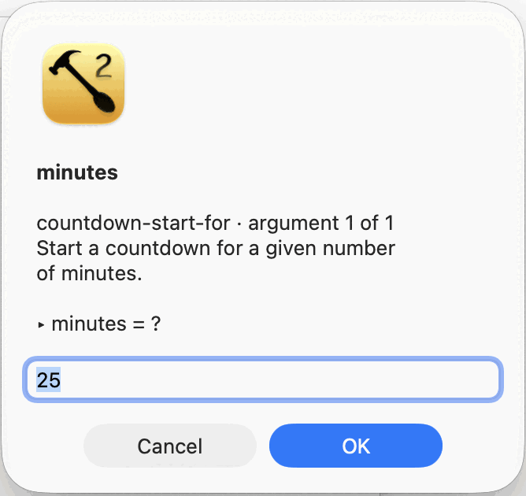

* hs_interactive-gt

Named commands for Hammerspoon 2. A command is a function with a name, such as
=window-left-half=, and a one-line description; it can be run by typing part of its name, and
keys are bound to it by name.

The design follows Emacs. A command declares how its arguments are read with an
=interactive= specification, as in Emacs Lisp, and the command chooser is the equivalent of
=M-x=.

The main features are these:

- *A command chooser.* It lists every command with its description, and with the key bound to
  it written as macOS writes keys, such as =window-maximize   ⌃⌥⌘M=. Typing part of a name or
  a description filters the list, and selecting a command runs it. The commands used most
  recently are listed first.
- *Arguments read when a command is run.* A command that acts on a window uses the focused
  window, or shows a chooser of windows when no window is focused. A command that takes a
  number shows a dialog for it. The same applies to applications, screens and text.
- *The same command called from code.* Called through =call()=, a command receives its
  arguments directly and shows no prompt.
- *Keys bound to command names.* Every binding can be listed, the command bound to a key can
  be looked up, and a command can be redefined without binding its key again.
- *=use()=, which configures a Spoon in one call.* It loads the Spoon, applies its settings,
  defines its commands, binds their keys, starts it, and records the outcome, in the manner of
  Emacs's =use-package=.

The command chooser, after =window= has been typed:

#+ATTR_HTML: :alt The command chooser listing ten commands that match window, each with its description and, for two of them, the key bound to it
[[./images/command-chooser.png]]

* Installing

The Spoon is installed and loaded with =hs.spoons.use()=:

#+begin_src js
hs.spoons.use("hs_interactive-gt", { source: "dmgerman/hammer2spoons" })
const interactive = hs.spoons["hs_interactive-gt"]
#+end_src

No other Spoon in this repository requires this one. The readme of each of them suggests
command definitions for it, to be written with =use()= as shown under /Loading Spoons/.

* Simple usage

This example defines one command, which moves a window to the left half of its screen, and
binds two keys:

#+begin_src js
const interactive = hs.spoons["hs_interactive-gt"]

interactive.define({
    name: "window-left-half",
    doc:  "Move a window to the left half of its screen.",
    interactive: [
        {
            name: "window",
            reader: interactive.readers.window.auto
        }
    ],
    fn: (win) => {
        const screen = win.screen.frame
        win.frame = new HSRect(screen.x, screen.y, screen.w / 2, screen.h)
    }
})

interactive.keysSet([
    [["cmd", "ctrl", "alt"], "left", "window-left-half"],
    [["cmd", "ctrl", "alt"], "x",    "commands-execute"]     // the command chooser
])
#+end_src

=fn= is the function the command runs. =interactive= lists its arguments, one entry per
argument, in the order =fn= takes them. This command has one argument, and its =reader= says
how the value is obtained: =readers.window.auto= takes the focused window, and shows a chooser
of windows when no window is focused.

The command can be run in two ways:

1. Pressing ⌃⌥⌘←, the key bound to it.
2. Pressing ⌃⌥⌘X, which runs =commands-execute= and so opens the command chooser, and then
   selecting =window-left-half= in it.

Either way the reader obtains the window first, and =fn= is then called with it.

* Defining commands

A command is defined with =define()=. This section describes its fields, the fields of each
argument, how commands are named, and the one field needed only by a command that opens a
chooser.

** define(spec)

=define(spec)= stores a command, and returns the stored command. /spec/ is an object with five
fields; only =name= and =fn= are required, and =define()= throws an =Error= when either is
missing.

| Field         | Meaning                                                          |
|---------------+------------------------------------------------------------------|
| =name=        | The command's name, hyphenated, such as =countdown-start=. See /Naming a command that belongs to a Spoon/. |
| =doc=         | A one-line description, shown in the command chooser and by =keyDescribe()=. |
| =fn=          | The function the command runs. It receives the arguments.        |
| =interactive= | How each argument is read. Omitted for a command that takes no argument. |
| =runDelay=    | Seconds to wait before running the command, when it is run from the command chooser. Defaults to 0. See /Commands that open a chooser/. |

Defining a command with a name that already exists replaces the earlier definition, so a
configuration can be reloaded without error.

#+begin_src js
interactive.define({
    name: "countdown-cancel",
    doc:  "Cancel the running countdown.",
    fn:   () => hs.spoons["hs_countdown-gt"].cancel()
})
#+end_src

** Interactive arguments

Each entry in =interactive= describes one argument of =fn=. This command takes a number of
minutes, read with a dialog that offers 25:

#+begin_src js
interactive.define({
    name: "countdown-start-for",
    doc:  "Start a countdown for a given number of minutes.",
    interactive: [
        {
            name: "minutes",
            reader: interactive.readers.number.prompted,
            default: 25
        }
    ],
    fn: (minutes) => hs.spoons["hs_countdown-gt"].startFor(minutes)
})
#+end_src

An entry has four fields:

| Field      | Meaning                                                              |
|------------+----------------------------------------------------------------------|
| =name=     | The argument's name, shown as the prompt's title and in the list of arguments. Defaults to =arg1=, =arg2= and so on. |
| =reader=   | How the value is obtained: one /variant/ of a reader. See /Readers/. |
| =default=  | The value the prompt offers, and the value used when the argument is skipped or the reader finds none. |
| =optional= | When true, the prompt offers *Skip*, which uses the default.         |

An entry may also be a bare function, which is then used as the reader of an argument named
=argN=.

=reader= takes a variant, such as =readers.number.prompted=, and not the reader itself, such as
=readers.number=. The command thereby states whether it prompts. Given a reader rather than a
variant, the command logs an error naming the argument and does not run.

Running =countdown-start-for= shows the dialog below. Its text names the command, the argument
requested and its position, and lists the values collected so far. The field holds the
argument's default, 25:

#+ATTR_HTML: :alt A dialog asking for minutes, for the command countdown-start-for, with 25 filled in

Cancelling any prompt cancels the command, and =fn= is not called.

** Naming a command that belongs to a Spoon

A command defined for a Spoon has that Spoon's name as its prefix, with =hs_= and =-gt=
removed:

| Spoon               | Prefix       | For example              |
|---------------------+--------------+--------------------------|
| =hs_countdown-gt=   | =countdown-= | =countdown-start-until=  |
| =hs_time-gt=        | =time-=      | =time-show=              |
| =hs_url-gt=         | =url-=       | =url-route-switch=       |

The command chooser lists the commands of every Spoon together, and nothing else in it shows
which Spoon a command belongs to. The prefix shows it, and it prevents two Spoons from defining
the same name for different operations. A command therefore takes the name of the Spoon it
calls even when another word would describe the operation better: =time-show= rather than
=clock-show=, because the Spoon is =hs_time-gt=.

Two kinds of command are not covered by the rule:

1. A command implemented in =init.js= itself calls no Spoon, so there is no Spoon to take a
   prefix from.
2. This Spoon's built-in commands begin with =commands-=, or are named =spoons-list=. See
   /Built-in commands/.

** Commands that open a chooser

A command that opens a chooser of its own requires =runDelay= when it is run from the command
chooser.

The command chooser runs the selected command from its =onSelect= callback, which is called
while the command chooser is still closing. A chooser that the command opens at that moment
does not become the key window reliably. Another window takes the key window instead, and the
new chooser closes as soon as it has opened. The same command run from a key works, because no
other chooser is closing then.

=runDelay= is the number of seconds to wait before running the command, which gives the
command chooser time to close. 0.05 seconds is enough. It applies only when the command is run
from the command chooser; a key runs the command without delay. The default is 0, and a command
that opens no chooser does not require it.

#+begin_src js
interactive.define({
    name: "menubar-choose",
    doc:  "Choose a macOS menu bar extra and press it.",
    // This command opens a chooser, so it waits for the command chooser to close first.
    runDelay: 0.05,
    fn:   () => hs.spoons["hs_menubar-gt"].choose()
})
#+end_src

* Readers

A reader obtains the value of an argument. Each reader provides up to three /variants/, and an
argument names the variant it uses:

- =implicit= takes the value from the /snapshot/, described below. When the snapshot has none,
  the argument takes its =default=.
- =prompted= always prompts, with a chooser or a dialog.
- =auto= takes the value from the snapshot when it has one, and prompts otherwise.

#+begin_src js
reader: interactive.readers.window.auto      // the focused window, or a chooser if there is none
reader: interactive.readers.window.prompted  // always a chooser
reader: interactive.readers.window.implicit  // the focused window, or the default
#+end_src

** The built-in readers

The Spoon provides five readers, as =interactive.readers.window= and so on:

| Reader                | =implicit= and =auto= take  | =prompted= shows             |
|-----------------------+-----------------------------+------------------------------|
| =readers.window=      | the focused window          | a chooser of windows         |
| =readers.application= | the frontmost application   | a chooser of running applications |
| =readers.screen=      | the focused window's screen | a chooser of screens         |
| =readers.number=      | —                           | a dialog, read as a number   |
| =readers.string=      | —                           | a dialog                     |

=readers.number= and =readers.string= have no =implicit= or =auto= variant, since there is no
current number or text to take.

Each row of the window chooser reads =Application — Title=, so typing either part of it finds
the window. When =readers.window.auto= finds no focused window, but the frontmost application
is known, it also shows an alert saying that the application reports no visible window. That
alert explains why a chooser appears instead of the command acting at once.

A number typed into a dialog that is not a number is reported in an alert, and the command is
cancelled.

** Narrowing what a reader offers

=readers.window.prompted= and =readers.screen.prompted= read options from the argument's entry,
which leave choices out of their chooser:

| Option              | Reader            | Default | Effect                                          |
|---------------------+-------------------+---------+-------------------------------------------------|
| =includeCurrent=    | window and screen | true    | false leaves out the window or screen the command started on. |
| =includeFullscreen= | screen            | true    | false leaves out screens showing a fullscreen window. |

A command that moves a window to another screen sets both to false:

#+begin_src js
interactive.define({
    name: "window-move-to-screen",
    doc:  "Move a window to a chosen screen.",
    interactive: [
        { name: "window", reader: interactive.readers.window.auto },
        { name: "screen", reader: interactive.readers.screen.prompted,
          includeCurrent: false, includeFullscreen: false }
    ],
    fn: (win, screen) => { /* ... */ }
})
#+end_src

When nothing is left to choose from, the reader shows an alert saying so, and the command is
cancelled.

Hammerspoon 2 has no =hs.spaces= module, so a screen counts as showing a fullscreen window when
a window on it reports =isFullscreen=.

** A number within a range

=readers.number.ranged(options)= returns a reader for a number between two bounds, which offers
the value a setting has when the prompt opens. It exists because =readers.number.prompted=
cannot do either: it accepts any number, and the argument's =default= is fixed when the command
is defined.

=options= has three fields, all optional:

| Field     | Meaning                                                                   |
|-----------+---------------------------------------------------------------------------|
| =min=     | The smallest value accepted.                                              |
| =max=     | The largest value accepted.                                               |
| =current= | A function returning the value to offer. When it returns null, or throws, the argument's =default= is offered instead. |

#+begin_src js
interactive.define({
    name: "system-volume-set",
    doc:  "Set the system's output volume, as a percentage.",
    interactive: [{
        name: "volume (0-100)",
        reader: interactive.readers.number.ranged({
            min: 0,
            max: 100,
            current: () => music.systemVolume()
        })
    }],
    fn: (percent) => music.systemVolumeSet(percent)
})
#+end_src

A value outside the range is reported in an alert, such as /volume (0-100): 150 is outside 0 to
100/, and the command is cancelled. The value is not clamped to the range.

=ranged= is a function to call, not a variant. What it returns is a reader, and goes in
=reader:= as =readers.number.prompted= does.

** The snapshot

The /snapshot/ records the focused window, the frontmost application and the focused window's
screen, or the main screen when no window is focused. It is taken when the command is invoked,
not when each argument is read. A chooser or a dialog takes the keyboard focus, and while one
is displayed, =hs.window.focusedWindow()= returns a window of Hammerspoon 2 itself.

A command run from a key takes its snapshot when the key is pressed. =commands-execute= takes
one before it shows the command chooser. Selecting =window-maximize= in the chooser therefore
resizes the window that was focused before the chooser appeared.

** Writing a reader

A reader variant is a function called as =(context, parameter, snapshot)=:

- /context/ is the text to display above a prompt: the command, its arguments and the values
  collected so far.
- /parameter/ is the argument's entry in =interactive=, including any options of its own.
- /snapshot/ is =({window, application, screen})=, and any of the three may be null.

It returns one of four things, or a promise of one:

1. The value.
2. =interactive.CANCEL=, which cancels the command.
3. =interactive.SKIP=, which gives the argument its default.
4. null or undefined, which also gives the argument its default.

The built-in readers group the variants of one reader in an object, and a new reader can do the
same. This one offers a chooser of the loaded Spoons:

#+begin_src js
const readSpoonName = {
    prompted: (context, parameter, snapshot) => new Promise((resolve) => {
        const chooser = hs.chooser.create()
        chooser.placeholder = "Spoon"
        chooser.setChoices(Object.keys(hs.spoons).map((name) => ({
            text: name,
            value: name
        })))
        chooser.onSelect = (item) => resolve(item ? item.value : interactive.CANCEL)
        chooser.show()
    })
}

interactive: [
    {
        name: "spoon",
        reader: readSpoonName.prompted
    }
]
#+end_src

A reader reads the focused window from /snapshot/, not from =hs.window.focusedWindow()=, for
the reason given under /The snapshot/.

** How values are displayed

=interactive.describe(value)= returns a short text for a value, as the prompts display it in the
list of arguments. A window is shown as its title and its application's name, a screen as its
name and size, and an application as its name. Any other Hammerspoon 2 object is shown through
its own =toString()=, without the type name, and a plain value as JSON.

* Calling commands

A command can be called from code in two ways: with every argument given, or with its readers
obtaining the arguments that are missing. This section also describes the command chooser and
how other code can learn that a prompt is open.

** call(name, ...args)

=call(name, ...args)= runs a command with the arguments given, and returns what its =fn=
returns. It shows no prompt. It throws an =Error= when no command has that name. It is the way
to run a command from other code.

#+begin_src js
interactive.call("countdown-start-for", 25)
#+end_src

** callInteractively(name, options)

=callInteractively(name, options)= obtains the command's missing arguments through its readers,
then runs it. It returns a promise of what =fn= returns, or of undefined when the command was
cancelled. Every key bound with this Spoon runs its command this way.

/options/ is optional, and has three fields:

| Option     | Meaning                                                           |
|------------+-------------------------------------------------------------------|
| =args=     | Arguments already known. A given argument is not read.            |
| =snapshot= | A snapshot taken earlier, as =commands-execute= takes one.        |
| =via=      | ="key"= when a key triggered the call, so that the call does not change the command's position in /Command order/. |

#+begin_src js
// Reads both arguments.
interactive.callInteractively("window-move-to-screen")

// Reads only the screen.
interactive.callInteractively("window-move-to-screen", { args: [win] })
#+end_src

** execute()

=execute()= shows the command chooser. Each row shows a command's name, the keys bound to it and
its description, and typing searches both the names and the descriptions. The built-in command
=commands-execute= calls it, and a key is usually bound to that command.

** get(name)

=get(name)= gives the definition of a command, for code that inspects a command or wraps it in
another. It returns the stored command, as =define()= returned it, or undefined when no command
has that name.

** promptChangeOn(fn) and promptIsOpen()

These two functions tell other code when a prompt of this Spoon is open, so that the code can
release keys a prompt requires.

=promptChangeOn(fn)= calls =fn(true)= when a prompt opens and =fn(false)= when the last open
prompt closes. It returns a function that ends the subscription. =promptIsOpen()= returns
whether a prompt is open.

A prompt requires every key press, and a hotkey receives a key press before a chooser does.
=hs_menu-gt= subscribes for that reason. Its on-screen menu binds a hotkey for each option's
letter, and while a prompt is open it releases them, so that a letter typed into a chooser
reaches the chooser.

Prompts are counted. A command that reads two arguments shows one prompt after another, and
=fn= is called once when the first opens and once when the last closes.

#+begin_src js
const unsubscribe = interactive.promptChangeOn((open) => {
    if (open) releaseKeys()
    else takeKeys()
})

unsubscribe()
#+end_src

* Command order

The command chooser, and =commands()=, list the commands in one of two orders:

- =mru=, the default: the most recently used commands first, followed by the commands never
  used, in alphabetical order.
- =alphabetic=: by name.

#+begin_src js
interactive.orderSet("alphabetic")
interactive.orderGet()                    // "alphabetic"

interactive.commands()                    // in the configured order
interactive.commands("alphabetic")        // in the order given
#+end_src

=orderSet()= throws an =Error= for any other value. The built-in command =commands-order-set=
sets the order from a chooser.

A command counts as used when it is run by name: from the command chooser, or through =call()=
or =callInteractively()=. A command run from its key does not change its position, so the
order follows the commands that have no key. Emacs does the same:
=extended-command-history= records what is run with =M-x=, and not what is run from a key.

A command counts as used once all its arguments have been read, so a command cancelled at a
prompt keeps its position. The order is held in memory, and is lost when the configuration is
reloaded.

* Loading Spoons

=use(name, spec)= loads and configures one Spoon. It replaces the statements that loading a
Spoon otherwise takes: =hs.spoons.load()=, a =try=/=catch= around it, the assignment of its
settings, the =define()= calls for its commands, and =keysSet()= for its keys. It returns the
Spoon, or null when the Spoon was not loaded.

#+begin_src js
// This Spoon is loaded first, since it provides use().
const interactive = hs.spoons.load("hs_interactive-gt")

interactive.use("hs_countdown-gt", {
    config: {
        defaultLenMinutes: 25,
        alertSound: "Sonar"
    },

    commands: (interactive, countDown) => {
        interactive.define({
            name: "countdown-start",
            doc:  "Start a countdown for the default number of minutes.",
            fn:   () => countDown.startFor()
        })
    },

    keys: [
        [["cmd", "ctrl", "alt"], "t", "countdown-start"]
    ]
})

// Not loaded.
interactive.use("PaperWM-gt", {
    disabled: true
})

interactive.use.report()
#+end_src

In this example, =config= sets two of the countdown Spoon's settings, =commands= defines one
command that calls it, and =keys= binds a key to that command. The Spoon's =start()= is called
last.

The Spoons are loaded in the order of the calls, so a Spoon that another one requires is
written first.

** Keywords

/spec/ takes the following keywords, each listed with its =use-package= equivalent:

| Keyword    | use-package | Meaning                                                        |
|------------+-------------+----------------------------------------------------------------|
| =disabled= | =:disabled= | When true, the Spoon is not loaded. The call stays in the configuration. |
| =when=     | =:if=       | A function. The Spoon is loaded only when it returns true.     |
| =before=   | =:init=     | A function called before the Spoon is loaded.                  |
| =config=   | =:custom=   | Settings merged into the Spoon's own =config= object.          |
| =after=    | =:config=   | A function called with the Spoon after it is loaded, used to connect two Spoons. |
| =commands= | =:commands= | A function called as =(interactive, spoon)=, which defines the Spoon's commands. |
| =keys=     | =:bind=     | A list of =[modifiers, key, command]=, bound with =keysSet()=. |
| =start=    | —           | When false, the Spoon's =start()= is not called.               |

Each call catches its own exceptions. A Spoon that fails to load is reported in the console,
and the calls after it still run. A bare =hs.spoons.load()= that throws, by contrast, stops the
rest of =init.js=.

** Where Spoons are looked for

=use()= loads a Spoon with =hs.spoons.load()=, which loads only from the =Spoons= directory of
the configuration. A Spoon kept in another directory can be loaded through a symbolic link in
=Spoons= with the Spoon's name.

** use.file(path, spec)

=use.file(path, spec)= loads a JavaScript file that is not a Spoon, for a configuration split
across several files. =path= is passed to =require()=, so a relative path is resolved from the
file that calls it. /spec/ takes =disabled=, =when= and =after=, which mean what they mean for
=use()=. It returns what the file exports, or null when the file was not loaded.

#+begin_src js
interactive.use.file("./work-only.js", {
    when: () => hs.appinfo.configDir.includes("work")
})
#+end_src

** use.report() and use.status()

These two functions report the outcome of every =use()= and =use.file()= call. The outcome is
one of =loaded=, =disabled=, =skipped= (when =when= returned false) and =failed=.

=use.report()= logs one line per call, followed by a summary, and returns the counts. It is
called at the end of =init.js=, and the built-in command =spoons-list= calls it at any time.

#+begin_example
[use] hs_countdown-gt      loaded    7 ms
[use] hs_time-gt           loaded    1 ms
[use] PaperWM-gt           disabled
[use] 2 loaded, 1 disabled, 0 skipped, 0 failed, in 8 ms
#+end_example

=use.status()= gives the same information to code, for example to check after a reload that
every Spoon is loaded. It returns an array of =({name, state, ms, error})=
objects, where =error= is the message of a failed call, and null otherwise.

* Key bindings

Keys are bound to command names, not to functions. A key can therefore be bound before its
command is defined, and a command can be redefined without binding its key again.

** keysSet(list)

=keysSet(list)= binds several keys. Each element of the list is =[modifiers, key, command]=:

#+begin_src js
interactive.keysSet([
    [["cmd", "ctrl", "alt"],          "t", "countdown-start"],
    [["cmd", "ctrl", "alt", "shift"], "t", "countdown-start-for"],
    [["cmd", "ctrl", "alt"],          "x", "commands-execute"]
])
#+end_src

The modifiers and the key are written as =hs.hotkey.bind()= takes them. The modifiers are
="cmd"=, ="ctrl"=, ="alt"= and ="shift"=, or their aliases ="command"=, ="control"= and
="option"=, or the symbols ="⌘"=, ="⌃"=, ="⌥"= and ="⇧"=. The keys are those that
=hs.hotkey.getKeyCodeMap()= lists, such as ="t"=, ="left"=, ="space"= and ="f1"=. An unknown
modifier or key throws an =Error= that names it.

=keysSet()= may be called any number of times. Each call adds its keys, and replaces the
binding of any key it names.

A key pressed when no command of its name is defined logs an error in the console.

** Other functions

These functions bind and remove one key, and report the bindings:

| Function                  | Returns or does                                            |
|---------------------------+------------------------------------------------------------|
| =keySet(mods, key, name)= | Binds one key, replacing any binding it has. Returns the binding, or null when macOS refuses the key. |
| =keyUnset(mods, key)=     | Removes a binding. Returns whether there was one.          |
| =keysOfCommand(name)=     | The keys bound to a command, as ={mods, key}= objects.     |
| =keyLabels(name)=         | The same keys as macOS writes them, such as ="⌃⌥⌘X"=.      |
| =keyLabel(binding)=       | One binding, as macOS writes it.                           |
| =keyDescribe(mods, key)=  | The command bound to a key, as ={mods, key, command, doc}=, or null. |
| =bindings()=              | Every binding, as ={mods, key, command}= objects.          |
| =stop()=                  | Removes every binding. The commands stay defined.          |

The Spoon keeps a reference to every hotkey it creates. In Hammerspoon 2, a hotkey with no
remaining reference is garbage-collected, and its key then does nothing.

* Built-in commands

The Spoon defines five commands of its own:

| Command                  | Does                                          |
|--------------------------+-----------------------------------------------|
| =commands-execute=       | Shows the command chooser, and runs the command selected. |
| =commands-order-set=     | Sets the order of the command chooser to =mru= or =alphabetic=. |
| =commands-key-describe=  | Shows the command bound to a key. The key is typed as words, such as =cmd ctrl alt v=. |
| =commands-bindings-list= | Logs every binding and its command.           |
| =spoons-list=            | Logs the outcome of every =use()= call.       |

By the rule in /Naming a command that belongs to a Spoon/, these names would begin with
=interactive-=. They are older than the rule, and they are not renamed because that would break
the key bindings of every configuration that uses them.

* Notes

- *A prompt brings Hammerspoon 2 to the front.* A dialog makes Hammerspoon 2 the frontmost
  application before it opens, and makes the previous application frontmost again when it
  closes. =hs.ui.textPrompt= shows a plain =NSWindow=, and a plain window cannot take the
  keyboard focus while its application is in the background. Without this, the dialog would
  appear but would not accept typing, and macOS would bounce the Dock icon instead. A chooser
  does not require this, because =hs.chooser= uses an =NSPanel= with =.nonactivatingPanel=,
  which accepts keys while its application is in the background.
- *Dialogs are modal.* =hs.ui.textPrompt= blocks Hammerspoon 2's main thread while it is
  displayed, and so suspends everything else, timers included.
- *One or two prompted arguments work best.* Hammerspoon 2 has no form with several fields, so
  each argument requires a dialog of its own. A command that requires more than two values is
  better served by one reader that reads a single combined answer.

* Requirements

- No other Spoon is required.
- When [[https://github.com/dmgerman/hammer2spoons/tree/main/Spoons/hs_windowfilter-gt.spoon2][hs_windowfilter-gt]] is loaded, the window chooser and the check for fullscreen windows
  use its record of the open windows. That is faster than asking every running application.
- The Accessibility permission, which Hammerspoon 2 requires to read and move windows.
