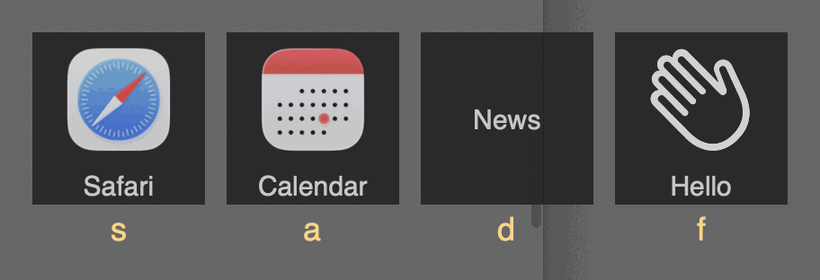
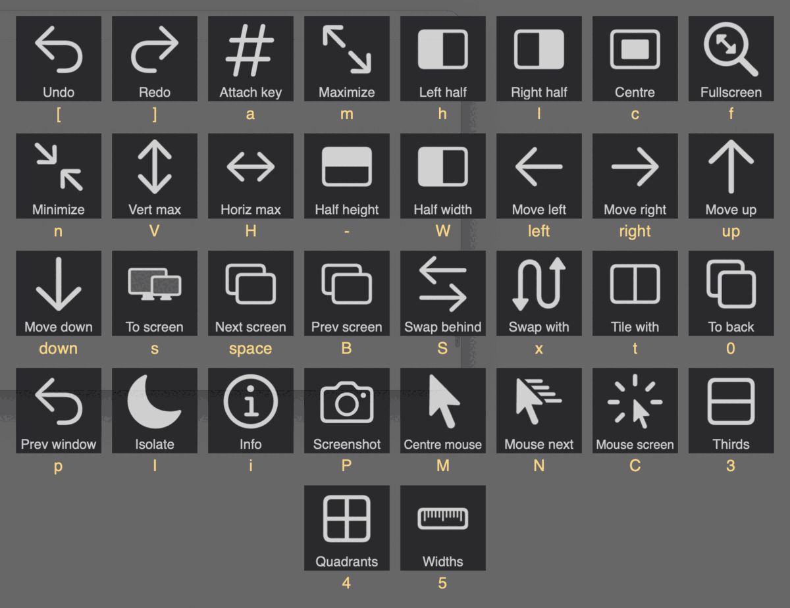

* hs_menu-gt

Open a menu of buttons on screen with one key, and press a letter to run what a button does.

A menu is a grid of buttons, each with an icon, a label and a letter beneath it. Pressing the
letter runs the button: it can bring an application forward, open a web page, run a command or
a function of your own, or open a submenu. Holding the letter, or pressing it with Control, runs
a second action, such as hiding the application instead of showing it.

You can use it like this:

- You press one key and see your most used applications, each under a letter. One more key
  brings one forward.
- Once you know a menu, you need not see it at all: set a short delay before it is drawn, and
  press the letters straight away.
- Buttons can show information that changes, such as the time or the audio device in use, and
  redraw themselves when it changes.
- The same menu can be shown on a Stream Deck as well, with
  [[https://github.com/dmgerman/hammer2spoons/tree/main/Spoons/hs_streamdeck-gt.spoon2][hs_streamdeck-gt]], so a button's action is written once.

A menu of four buttons, each with its letter beneath it:

#+ATTR_HTML: :alt A menu of four buttons, Safari, Calendar, News and Hello, with the letters s, a, d and f beneath them

* Installing

The first time this runs, Hammerspoon 2 downloads the Spoon from this repository; after that
it loads the installed copy:

#+begin_src js
hs.spoons.use("hs_menu-gt", { source: "dmgerman/hammer2spoons" })
#+end_src

To keep a particular version, add =ref= with a tag or a commit. To get a newer version, call
=hs.spoons.update("hs_menu-gt")=.

A button can run a command by name, defined with
[[https://github.com/dmgerman/hammer2spoons/tree/main/Spoons/hs_interactive-gt.spoon2][hs_interactive-gt]].
That Spoon is optional: only buttons with =command:= need it. Buttons with =fn:=, =app:= or
=url:= work without it.

* Simple usage

#+begin_src js
const menu = hs.spoons["hs_menu-gt"]

const mainMenu = [
    { label: "Safari",   app: "com.apple.Safari", key: "s" },
    { label: "Calendar", app: "com.apple.iCal" },
    { label: "News",     url: "https://news.ycombinator.com" },
    { label: "Hello",    icon: "symbol:hand.wave", fn: () => hs.ui.alert("Hello").show() }
]

hs.hotkey.bind(["cmd", "ctrl", "alt"], "z", () => menu.onScreenShow(mainMenu), null)
#+end_src

Pressing ⌃⌥⌘Z opens the menu in the middle of the screen you are working on. Pressing =s=
brings Safari forward and closes the menu. Escape closes it without doing anything.

* Buttons

Every field is optional, though a button with none of them is an empty square.

| Field            | Meaning                                                            |
|------------------+--------------------------------------------------------------------|
| =label=          | Text drawn on the button, beneath the icon.                        |
| =icon=           | The picture. See /Icons/.                                          |
| =hideLabel=      | Draw the icon without the label.                                   |
| =key=            | The letter that selects it on screen. Assigned when omitted.       |
| =command=        | Name of the command a short press runs. Needs hs_interactive-gt.   |
| =args=           | Arguments passed to that command.                                  |
| =altCommand=     | Name of the command a long press runs.                             |
| =altArgs=        | Arguments passed to that command.                                  |
| =children=       | A submenu. Anything a menu may be; see /Menus/.                    |
| =app=            | Bundle ID. A short press brings it forward, a long press hides it. |
| =url=            | Opened on a press.                                                 |
| =urlBundle=      | Bundle ID of the browser to open =url= in.                         |
| =fn=             | A function, called as =fn(context, button)= on a short press.      |
| =altFn=          | The same, for a long press.                                        |
| =navigate=       | Which menu is shown after a press: ="stay"=, ="parent"= or ="root"=. |
| =keepOpen=       | Whether a menu that can hide stays displayed. See /Menus/.         |
| =background=     | Background colour of the button, as a hex string.                  |
| =labelColor=     | Colour of the label.                                               |
| =image=          | A ready-made =HSImage=, used as it is.                             |
| =imageProvider=  | Draws the button. See /Buttons that draw themselves/.              |
| =stateProvider=  | What the button depends on. It is redrawn only when this changes.  |
| =updateInterval= | Seconds between checks.                                            |

An action is chosen in this order: =fn=, =command=, =app=, =url=. A short press on a button
with =children= opens the submenu and ignores the rest.

* Menus

A menu is one of three things, and =children= accepts any of them:

| Shape                     | For                                                      |
|---------------------------+----------------------------------------------------------|
| an array of buttons       | The usual menu.                                          |
| a function returning one  | A menu computed when it is opened, not when defined.     |
| =\{buttons, keepOpen\}=     | A menu with a default for its buttons. See /keepOpen/.   |

#+begin_src js
const flat = [ { label: "One" }, { label: "Two" } ]

const computed = () => hs.window.allWindows().map((w) => ({ label: w.title }))

const withDefault = {
    keepOpen: true,
    buttons: [ { label: "Vol +" }, { label: "Vol −" } ]
}
#+end_src

In the object form, =buttons= may itself be a function, so a computed menu can have a default
too.

** Actions

#+begin_src js
// A command, with an argument given by the menu
{ label: "25 min", command: "countdown-start-for", args: [25] }

// Different actions for a tap and a hold
{
    label: "Mail",
    icon: "bundle:com.apple.mail",
    command:    "mail-open",
    altCommand: "mail-compose"
}

// A submenu computed when it is opened
{ label: "Windows", children: () => hs.window.allWindows().map((w) => ({
    label: w.title,
    fn: () => w.focus()
})) }
#+end_src

A command runs through hs_interactive-gt's =callInteractively=, so a command whose arguments
the menu does not give asks for them, as it would when run from its key. A command that shows
a dialog blocks Hammerspoon while the dialog is open, because =hs.ui.textPrompt= is modal.

** After a press: navigate and keepOpen

After a press, two things are decided, and only the second depends on the device.

*** navigate

Which menu is displayed after the press. This applies to every presenter, because every one
has a stack of menus.

| =navigate=  | After acting                                            |
|-------------+---------------------------------------------------------|
| ="parent"=  | Back to the menu this one was opened from. The default. |
| ="stay"=    | Stays in this menu.                                     |
| ="root"=    | Back to the root menu.                                  |

*** keepOpen

Whether the menu remains displayed. This applies only to a presenter that can hide: a Stream
Deck always displays something, so =keepOpen= has no effect on it. It defaults to false, which
suits a menu opened for one action. Set it to true for a button that is pressed several times
in a row.

#+begin_src js
// Pressed several times in a row: stay in this menu, and keep it displayed.
{ label: "Vol +5", command: "music-volume-up", navigate: "stay", keepOpen: true }

// Opens a chooser, which needs the keyboard, so the on-screen menu closes. navigate: "stay"
// leaves a Stream Deck where it was, and the on-screen menu reopens here rather than at the
// root.
{ label: "Choose album", command: "album-choose", navigate: "stay" }
#+end_src

Because the two are separate, one button suits both devices. A presenter added later uses
=navigate= like any other, and =keepOpen= only if it can hide.

A button with a submenu uses neither: a short press on it opens the submenu.

**** A default for a whole menu

When most buttons of a menu need the same =keepOpen=, it can be set once for the menu. Write
the menu as an object rather than an array: =buttons= holds the menu, and =keepOpen= beside it
is the default.

#+begin_src js
const windowMenu = {
    // A window is usually placed once, so a press closes the menu...
    keepOpen: false,
    buttons: [
        { label: "Maximize", command: "window-maximize" },          // closes
        { label: "Undo", command: "window-undo", keepOpen: true },  // ...except this one
        { label: "Thirds", children: () => thirdsMenu }             // submenu: stays
    ]
}
#+end_src

A button's own =keepOpen= always takes precedence. Only a button without one takes the menu's
default.

Two kinds of button do not take the default:

- *A button with a submenu* stays open whatever the menu's default is. A short press opens
  the submenu, and a hold runs the button's action, which should not close the menu either.
- *A button in a menu written as an array*, which has no place for a default.

* Example: a window menu

A menu that places and moves the focused window, using
[[https://github.com/dmgerman/hammer2spoons/tree/main/Spoons/hs_window-gt.spoon2][hs_window-gt]]. Each button
calls one of its functions with =fn:=, so the menu does not need hs_interactive-gt. The menu's
keys do not take the keyboard focus, so the focused window is still yours when a button runs.

#+begin_src js
const menu = hs.spoons["hs_menu-gt"]
const win = hs.spoons["hs_window-gt"]

const thirds = [
    { label: "Left third",   icon: "symbol:rectangle.leadinghalf.inset.filled",  fn: () => win.leftThird() },
    { label: "Centre third", icon: "symbol:rectangle.center.inset.filled",       fn: () => win.centerThird() },
    { label: "Right third",  icon: "symbol:rectangle.trailinghalf.inset.filled", fn: () => win.rightThird() }
]

const windowMenu = {
    // A window is usually placed once, so a press closes the menu.
    keepOpen: false,
    buttons: [
        { label: "Undo",        icon: "symbol:arrow.uturn.backward", key: "[", fn: () => win.undo(), keepOpen: true },
        { label: "Redo",        icon: "symbol:arrow.uturn.forward",  key: "]", fn: () => win.redo(), keepOpen: true },
        { label: "Attach key",  icon: "symbol:number",               key: "a", fn: () => win.keyToWindowAttach() },
        { label: "Maximize",    icon: "symbol:arrow.up.left.and.arrow.down.right", key: "m", fn: () => win.maximize() },
        { label: "Left half",   icon: "symbol:rectangle.lefthalf.filled",  key: "h", fn: () => win.leftHalf() },
        { label: "Right half",  icon: "symbol:rectangle.righthalf.filled", key: "l", fn: () => win.rightHalf() },
        { label: "Centre",      icon: "symbol:rectangle.center.inset.filled", key: "c", fn: () => win.center() },
        { label: "Vert max",    icon: "symbol:arrow.up.and.down",    key: "V", fn: () => win.verticalMaximize() },
        { label: "Horiz max",   icon: "symbol:arrow.left.and.right", key: "H", fn: () => win.horizontalMaximize() },
        { label: "Half height", icon: "symbol:rectangle.tophalf.filled", key: "-", fn: () => win.halfHeight() },
        { label: "Half width",  icon: "symbol:rectangle.lefthalf.filled", key: "W", fn: () => win.halfWidth() },
        { label: "Next screen", icon: "symbol:rectangle.on.rectangle", key: "space", fn: () => win.windowToScreenMove("next") },
        { label: "Prev screen", icon: "symbol:rectangle.on.rectangle", key: "B", fn: () => win.windowToScreenMove("previous") },
        { label: "Swap behind", icon: "symbol:arrow.left.arrow.right", key: "S", fn: () => win.windowWithPreviousSwap() },
        { label: "To back",     icon: "symbol:square.on.square",     key: "0", fn: () => win.windowToBackSend() },
        { label: "Prev window", icon: "symbol:arrow.uturn.left",     key: "p", fn: () => win.windowPrevious() },
        { label: "Isolate",     icon: "symbol:moon.fill",            key: "I", fn: () => win.isolationToggle() },
        { label: "Info",        icon: "symbol:info.circle",          key: "i", fn: () => win.info() },
        { label: "Thirds",      icon: "symbol:rectangle.split.3x1",  key: "3", children: thirds }
    ]
}

hs.hotkey.bind(["alt"], "w", () => menu.onScreenShow(windowMenu, { name: "Windows" }), null)
#+end_src

Undo and Redo set =keepOpen: true=, so they can be pressed several times in a row; every other
button closes the menu. A larger version of this menu, with buttons for moving the pointer and
taking a screenshot:

#+ATTR_HTML: :alt A window menu of thirty buttons, such as Undo, Maximize, Left half, Next screen and Isolate, each with an SF Symbol and its letter

* Buttons that draw themselves

A button with =imageProvider= draws its own picture, so it can show the time, a temperature,
or which audio device is selected.

#+begin_src js
const clockButton = {
    label: "Clock",
    updateInterval: 10,
    stateProvider: () => new Date().getHours() + ":" + new Date().getMinutes(),
    imageProvider: (context) => ({
        label: JSON.parse(context.state),
        background: "#F5C542",
        labelColor: "#101014"
    })
}
#+end_src

=stateProvider= returns whatever the button depends on. It is called every =updateInterval=
seconds, and its result is compared with the last one, as text, so an object or an array is
compared by value. The button is redrawn only when the result differs, which is why the example
above is checked every ten seconds but drawn once a minute.

A button with =updateInterval= and no =stateProvider= is redrawn at every interval.

=imageProvider(context)= receives ={session, index, state}=, where =state= is the text
=stateProvider= returned, and returns any of:

| Returns              | Meaning                                                       |
|----------------------+---------------------------------------------------------------|
| button fields        | Merged over the button and drawn as any other button is.      |
| a string             | Drawn as the button's label.                                  |
| an =HSImage=         | Used as it is.                                                |
| a promise of any     | Waited for.                                                   |

Returning button fields is usually best: icons, colours, labels and text wrapping all work as
they do for any other button.

** What is not cached

A button that draws itself is never written to the cache of tiles on disk. Otherwise a clock
would leave a file behind every minute. It is redrawn whenever its state changes, so keep
=imageProvider= fast, and put anything slow in =stateProvider=, whose result is reused.

** Where they are redrawn

Buttons are redrawn both on screen and on a Stream Deck. A presenter that cannot change what it
displays draws them once, when the menu opens; =session.update(index)= redraws one on demand.

* Icons

=icon= accepts any of these:

| Form                      | Meaning                                              |
|---------------------------+------------------------------------------------------|
| ="bus_7.png"=             | A file in =config.iconDir=, which you supply.        |
| ="~/pictures/x.png"=      | An absolute or =~=-relative path.                    |
| ="symbol:hammer"=         | An SF Symbol, recoloured to =config.symbolColor=.    |
| ="bundle:com.apple.Mail"= | An application's icon.                               |
| an =HSImage=              | Used as it is.                                       |

A button with =app= and no =icon= uses that application's icon.

SF Symbols are template images, black on transparent, so they are recoloured to be visible on
a dark button.

* Letters

Each button on screen has a letter beneath it, which selects it. A button's own =key= is used
when it has one, and the other buttons are given unused letters from =config.alphabet=, home
row first. In a menu with more buttons than the alphabet has letters, the buttons left over
have no letter: they can be pressed on a Stream Deck but not from the keyboard.

Declaring =key= on the buttons you use most keeps their letters the same as a menu grows, which
matters most for a menu whose contents are computed.

* Presses

A press is reported as the button going down and later coming up, on both devices: a Stream
Deck reports it through its button callback, and the on-screen menu binds each letter with a
press and a release handler. The same code then decides whether it was a short press or a long
press, so a hold works the same way on either device.

A hold runs as soon as =config.holdSeconds= has passed, while the button is still down, as the
Hammerspoon 1 Spoon did. The release that follows is ignored.

** From the keyboard

Case matters: =a= and =A= select two different buttons. Holding a letter runs the button's
hold action, and so does Control with the same letter, which is quicker because it does not wait
for =holdSeconds=.

| Key            | Runs                                       |
|----------------+--------------------------------------------|
| =a=            | The button lettered =a=                    |
| =A=            | The button lettered =A=                    |
| =ctrl-a=       | The hold action of the button lettered =a= |
| =ctrl-shift-a= | The hold action of the button lettered =A= |

Control is bound only for a button that has a hold action, so otherwise the key combination
stays available to other applications. It adds no action a Stream Deck lacks: it is the same
action a hold runs.

A button asks for a capital letter as it asks for any letter, with =key: "A"=. Letters given
out automatically are always lower case, so a button's letter does not change case as the menu
grows. Digits work as letters do, without a capital form: =ctrl-0= runs the hold action of the
button lettered =0=.

* The on-screen menu

#+begin_src js
menu.onScreenShow(rootMenu, { name: "Root" })   // replaces any menu displayed
menu.onScreenToggle(rootMenu)                   // hides it if it is displayed
menu.onScreenHide()
menu.onScreenIsShown()
menu.onScreenPositionReset()                    // the next menu opens at its root
#+end_src

While the menu is displayed, its letters are bound for the whole system, so key presses go to
the menu until it is closed.

| Key      | Does                          |
|----------+-------------------------------|
| a letter | Selects that button.          |
| Escape   | Closes the menu.              |
| Delete   | Returns to the parent menu.   |

The menu opens in the middle of the screen holding the focused window, and stays on that screen
until it closes, so a submenu opens where its parent was. Opening a menu again after closing it
returns to the submenu you were in. =onScreenPositionReset()= makes it open at its root instead.

A command that shows a chooser or a dialog needs the keyboard. While hs_interactive-gt has one
open, the menu stays displayed but releases its keys, and takes them back when the chooser or
dialog closes.

* Configuration

Settings are on =menu.config=.

| Setting            | Default                    | Meaning                                     |
|--------------------+----------------------------+---------------------------------------------|
| =iconDir=          | =<config>/icons=           | Where a relative icon name is looked up.    |
| =cacheDir=         | =<config>/.cache/menu-gt=  | Where drawn buttons are kept.               |
| =tileSize=         | 96                         | Edge of a button image, in points.          |
| =holdSeconds=      | 0.5                        | A press this long is a long press.          |
| =alphabet=         | home row first             | Letters given to buttons without a =key=.   |
| =urlBundle=        | null                       | Browser for =url= buttons.                  |
| =iconScale=        | 0.74                       | Icon size with a label beneath it.          |
| =iconScaleAlone=   | 0.94                       | Icon size without a label.                  |
| =background=       | =#101014=                  | Button background.                          |
| =labelColor=       | =#F0F0F0=                  | Label colour.                               |
| =labelSize=        | 15                         | Size a label starts at. Long labels shrink. |
| =labelSizeFloor=   | 9                          | How far a label may shrink before it is cut.|
| =font=             | Helvetica                  | Font of the labels and letters.             |
| =symbolColor=      | =#FFFFFF=                  | Colour SF Symbols are drawn in.             |
| =alpha=            | 0.8                        | How transparent the whole menu is.          |

=<config>= is Hammerspoon 2's configuration directory.

=alpha= runs from 0 for invisible to 1 for opaque, and sets the transparency of the whole menu
on screen: the panel behind the buttons, and each button with its background, icon and label.
So the whole menu is equally transparent, rather than opaque buttons on a transparent panel. It
is applied when the menu is displayed, not when a button is drawn, so changing it needs no
cache cleared. A Stream Deck cannot show transparency and is unaffected. The panel's own colour
may also have an alpha, as an eight-digit hex colour; the default, =#1C1C1EF5=, already does,
and the two are multiplied.

=font= is a font's PostScript name, such as ="Helvetica-Bold"=, not its display name
="Helvetica Bold"=. Null draws in the system font, and so does a name that cannot be found,
with a warning in the console.

=config.screen= holds the settings of the on-screen menu: =tile=, =spacing=, =padding=,
=background=, =letterSize=, =letterColor=, =level=, =showDelay=, =cancelKeys=, =backKeys=, and
=columnsFor(count)=, which returns the number of columns for a given number of buttons.

=showDelay= is how long to wait, in seconds, before drawing the menu. It defaults to 0, which
draws it at once. The letters are bound as soon as the menu is opened, so with a delay set, a
letter pressed within it acts, and the menu is never drawn. Someone who knows a menu does not
see it, and someone who needs to look does. Until the menu is drawn, each submenu waits the
delay again, so opening a submenu quickly draws nothing either. Once the menu is on screen, a
new submenu replaces it at once.

* How buttons are drawn

A button is drawn with =hs.canvas=, as a background rectangle, the icon as an =image= element
and the label as one =text= element, and exported with =imageFromCanvas()=. The image is
twice the tile size in pixels, so a 96 point tile is a 192 pixel image. Drawing one takes a
few milliseconds.

Three details:

- *An SF Symbol is recoloured in a canvas of its own.* The symbol gives the shape, and a
  filled rectangle drawn with the =sourceIn= composite rule colours it. This cannot be done in
  the tile itself, because a composite rule applies to everything already drawn in the same
  canvas, which would colour the tile's background instead of the symbol.
- *An icon is resized before it is drawn.* A canvas draws an image at the resolution it
  already has, so a symbol left at its own size would be blurred when drawn larger. Its longer
  side is scaled to twice the tile size, and =imageScaling: scaleProportionally= fits it to
  its frame without stretching it.
- *The label is measured.* =minimumTextSize()= reports the size a string needs in the font
  being drawn, so wrapping and shrinking use that font. A label starts at =labelSize=, is
  wrapped to the available width, and is made one point smaller at a time until it fits or
  reaches =labelSizeFloor=. If it still does not fit, it is cut short with an ellipsis. Beneath
  an icon a label has one line, and on its own up to three.

Each finished button is saved in =cacheDir= as a PNG and used again, so it is drawn once rather
than every time it is displayed. A button that did not come out as asked, such as one whose icon
could not be loaded, is displayed but not saved, so that the next time the icon is tried again.

#+begin_src js
menu.imageCacheClear()   // forget the images held in memory
menu.diskCacheClear()    // delete the saved buttons as well
#+end_src

Call =diskCacheClear()= after changing =tileSize=, the colours or the fonts. A saved button is
identified by its icon and label, not by the settings it was drawn with, so it would otherwise
be used again.

* Writing a presenter

A presenter displays a menu on one kind of device. It is an object with these members.
=sessionOpen(menu, presenter, options)= opens a menu on a presenter and returns the session.

| Member                      | Meaning                                                        |
|-----------------------------+----------------------------------------------------------------|
| =progressive=               | True if the display can be changed after it is shown.          |
| =canHide=                   | True if the presenter can hide the menu, so =keepOpen= applies. |
| =present(session, buttons)= | Display a page. Called whenever another menu is opened.        |
| =setImage(index, image)=    | Set one button's image. Progressive presenters only.           |
| =keysSuspend()=             | Release the keyboard. Optional; see below.                     |
| =keysResume()=              | Take the keyboard again.                                       |
| =close()=                   | The menu was closed.                                           |

A progressive presenter is given the page at once and each image as it is drawn. One that cannot
change what it displays is given the page only when every image is ready, with each button's
=image= already set. =buttonImage(button, options)= draws one button, for a presenter that
needs it.

A presenter that uses the keyboard implements =keysSuspend= and =keysResume=. They are called
when hs_interactive-gt opens a chooser or a dialog, since a hotkey receives a key press before a
chooser does: without them, the on-screen menu would act on the arrow keys meant for the
chooser. While suspended, =present= must not bind the keys again, even when the menu redraws.
A presenter with no keyboard of its own, such as a Stream Deck, leaves both out.

The session offers =down(index)=, =up(index)=, =activate(index, kind)=, =push(button)=,
=pop()=, =popToRoot()=, =refresh()=, =update(index)=, =close()=, =canPop()=, =buttons()=,
=letters()=, =indexOfLetter(letter)= and =title()=.

Report presses with =down= and =up= rather than running a button's action directly, so that a
hold is recognised. Each presenter has its own session, so opening a submenu on one device does
not change the menu displayed on another.

* Notes

- *A menu that is a function is computed when it is opened*, so a menu of running applications
  or open windows lists what exists at that moment.
- *Opening another menu stops the drawing of the previous one.* A menu can take seconds to draw
  the first time, which is long enough to open a submenu. Images that belong to a menu no longer
  displayed are not drawn.
- *Only a frontmost application is hidden.* An =app= button starts an application that is not
  running, but a long press hides it only when it is frontmost.
