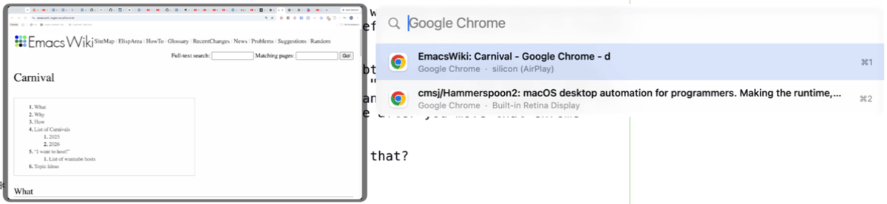

* hs_selectWindow-gt

hs_selectWindow-gt switches to any open window by typing part of its title. macOS switches
between applications with ⌘-Tab, and between the windows of the application in front with ⌘-`,
but it cannot switch to a window of another application by its title. With this Spoon, one key
opens a chooser of the open windows, most recently used first, and typing narrows the list.

Its main features are these:

- *A chooser of windows, most recently used first.* The focused window is not listed, so the
  window used before it is the first row, and Return switches to it.
- *Search by title or by application.* A row is listed when the window's title, or the
  application's name beneath it, contains the text typed.
- *Minimized and hidden windows.* A minimized window, or a window of a hidden application, is
  listed too, and marked as such.
- *Applications without windows.* A running application that has no window, such as one whose
  last window was closed, is listed after the windows, and choosing it brings it to the front.
- *A thumbnail of the selected window,* shown beside the chooser and turned on or off with
  =Tab=, for windows whose titles look alike.
- *Switching within one application,* with a chooser of that application's windows only.
- *Switching back to the previous window,* with no chooser.
- *Switching to one application with one key,* and back to where the user was when the same key
  is pressed again.

The following screenshot shows the chooser limited to Chrome's windows, with the thumbnail of
the selected window to its left:

#+ATTR_HTML: :alt The window chooser listing two Google Chrome windows, with a thumbnail of the selected one, an EmacsWiki page, to its left

* Installing

This Spoon requires three other Spoons from this repository, which must be loaded before it:

- [[https://github.com/dmgerman/hammer2spoons/tree/main/Spoons/hs_interactive-gt.spoon2][hs_interactive-gt]] is told when the chooser opens and closes. Other
  Spoons that bind keys, such as hs_menu-gt, then release those keys while the chooser is open,
  so that the text typed reaches the chooser.
- [[https://github.com/dmgerman/hammer2spoons/tree/main/Spoons/hs_windowfilter-gt.spoon2][hs_windowfilter-gt]] keeps a record of the open windows and reports which one receives the
  focus. This Spoon takes its list of windows, and their order, from hs_windowfilter-gt.
- [[https://github.com/dmgerman/hammer2spoons/tree/main/Spoons/hs_window-gt.spoon2][hs_window-gt]] focuses the chosen window and moves it between screens. It requires
  [[https://github.com/dmgerman/hammer2spoons/tree/main/Spoons/hs_menu-gt.spoon2][hs_menu-gt]] in turn.

The following configuration installs all five Spoons. It binds ⌥B to the chooser of every
window, and ⌥` to the previously used window:

#+begin_src js
hs.spoons.use("hs_interactive-gt", { source: "dmgerman/hammer2spoons" })
hs.spoons.use("hs_windowfilter-gt", { source: "dmgerman/hammer2spoons" })
hs.spoons.use("hs_menu-gt", { source: "dmgerman/hammer2spoons" })
hs.spoons.use("hs_window-gt", { source: "dmgerman/hammer2spoons", start: true })
hs.spoons.use("hs_selectWindow-gt", {
    source: "dmgerman/hammer2spoons",
    start: true,
    hotkeys: { windowSelect: [["alt"], "b"], windowPreviousSelect: [["alt"], "`"] }
})
#+end_src

When a required Spoon is not loaded, =start()= throws an error that names the missing Spoon.

* Examples

The functions are called on the loaded Spoon. These are the calls most often bound to keys:

#+begin_src js
const sw = hs.spoons["hs_selectWindow-gt"]

sw.windowSelect()                       // choose from every window
sw.applicationWindowSelect()            // choose from the focused application's windows
sw.applicationSelect()                  // choose an application, by its most recent window
sw.windowPreviousSelect()               // focus the last used window, with no chooser
sw.applicationByBundleSelect("org.gnu.Emacs")   // switch to Emacs, or back from it
#+end_src

* The order of the windows

Every chooser lists windows in the order in which they were last focused, the most recent
first. The focused window is left out, because choosing it would change nothing, so the first
row is the window used before it. This Spoon records each change of focus as hs_windowfilter-gt
reports it. A minimized window therefore keeps its place in the order.

The order begins when this Spoon starts. At that moment the focused window is placed first, and
the other open windows follow in no particular order. Each later change of focus corrects the
order. A window that has not been focused since this Spoon started is listed after every window
that has.

=order()= shows this order in the Hammerspoon 2 console; see /Functions/.

* The chooser

The chooser lists one row per window. Each row shows the window's title. Beneath the title it
shows the application, the screen the window is on, and the words "minimized" or "hidden" when
they apply.

Typing narrows the rows. A row is listed when its title, or the line beneath it, contains the
text typed. The text is matched as a whole, so =mail= finds a window whose title contains "mail",
and =chrome= finds every Chrome window, but =mail chrome= finds neither. Return focuses the
selected window and brings its application forward.

Only standard windows are listed, so panels, sheets and other auxiliary windows are omitted.
Windows of the applications in =config.skipApplications= are never listed.

While the chooser is open, two keys control the thumbnail. =Tab= turns it on or off, and
=Shift+Tab= takes a new snapshot of the selected window. Both keys can be changed; see
/Settings/.

** The thumbnail

The thumbnail is a snapshot of the selected window, drawn to the left of the chooser. It is off
by default. It is turned on by setting =config.showThumbnail= to true, or by pressing =Tab=
while the chooser is open.

A snapshot is taken the first time a window is selected, and kept while the chooser is open, so
selecting that window again shows it at once. =Shift+Tab= takes a new snapshot of the selected
window, for a window whose contents have changed. The snapshots are discarded when the chooser
closes, unless =config.persistentThumbnailCache= is true.

The thumbnail's height is at most =config.thumbnailHeightRatio= of the screen's height. A
snapshot smaller than that is drawn at its own size, and is not enlarged.

Taking a snapshot requires the Screen Recording permission. Without it, the chooser works and
shows no thumbnails.

* Functions

This Spoon exports the following functions. Those whose name ends in =Select= either open a
chooser and focus the window chosen in it, or focus a window directly.

** windowSelect()

=windowSelect()= opens a chooser of every window except the focused one, most recently used
first. The running applications that have no window follow them, in alphabetical order, each as
a row /Name (no windows)/ with the application's bundle identifier beneath it. Choosing such a
row brings the application to the front. Only applications with a Dock icon are listed, once
each, and not the application in front. An application counts as having windows when any copy
of it has one, so a second copy of an application, such as a browser started in kiosk mode, is
not listed beside the first.

** applicationWindowSelect([application])

=applicationWindowSelect()= opens a chooser of one application's windows, most recently used
first. Without an argument, the application is the one whose window has the focus. With an
argument, it is the application with that name:

#+begin_src js
sw.applicationWindowSelect()            // the focused application
sw.applicationWindowSelect("Emacs")     // the application named Emacs
#+end_src

The chooser's prompt shows the application's name.

** applicationSelect()

=applicationSelect()= opens a chooser with one row per application. Each row shows that
application's most recently used window, and choosing the row focuses that window. The
application of the focused window is not listed, since its row would be the focused window.
The running applications that have no window follow, as in =windowSelect()=.

** windowPreviousSelect()

=windowPreviousSelect()= focuses the window used before the current one, without opening a
chooser. That window is the first row of =windowSelect()='s chooser, as described under /The order
of the windows/. When there is no such window, an alert says so. The function returns whether it
focused a window.

hs_window-gt, which this Spoon requires, has a similar function, =windowPrevious()=. The two
differ in the windows they consider. This function follows this Spoon's order, which includes
minimized windows and windows of hidden applications, and =windowPrevious()= does not.

** applicationWindowPreviousSelect()

=applicationWindowPreviousSelect()= focuses the window of the application in front that was used
before the current window, without opening a chooser. Pressed repeatedly, it switches between the
two most recently used windows of one application, such as two windows of an editor. When the
application has only one window, an alert says so. The function returns whether it focused a
window.

** applicationByBundleSelect(bundleID, [titlePattern])

=applicationByBundleSelect()= switches to an application, or back from it. With a key bound to
it for an application, the same key switches to that application and, pressed again, switches
back. It does one of three things:

1. When the application is not in front, it focuses the application's most recently used
   window.
2. When the application is in front, it focuses the most recently used window of another
   application.
3. When the application is not running, or has no window, it starts the application or brings
   it forward.

#+begin_src js
sw.applicationByBundleSelect("org.gnu.Emacs")
sw.applicationByBundleSelect("net.kovidgoyal.kitty", /^notes/)
#+end_src

Switching back goes to another application's window, not to the previous window. Otherwise an
application with two windows would switch between its own two windows, which is what
=applicationWindowPreviousSelect()= does.

The application is identified by its bundle identifier, such as ="com.apple.Safari"=. A renamed
or translated application is therefore still found.

=titlePattern= is optional. It is a =RegExp=, or a string that is converted to one. With a
pattern, only the application's windows whose title matches it are switched to, the most
recently used first. Switching back then goes to the most recently used window whose title does
not match, which may belong to the same application. When none of the application's windows
matches, the application's current window is used, and an alert says so. An empty pattern is
the same as no pattern.

A title pattern is useful only for a window whose title does not change. A browser window's
title changes with its tab, while a terminal window that has been given a name keeps it.

The function returns whether it switched to anything.

** order()

=order()= shows the order in which the chooser lists the windows, without opening it. It is
used in the Hammerspoon 2 console, to find out why a window is listed where it is, or which
window =windowPreviousSelect()= will focus:

#+begin_src js
hs.spoons["hs_selectWindow-gt"].order().slice(0, 3)
// [ "Google Chrome: Inbox", "kitty: notes", "Emacs: readme.org" ]
#+end_src

Each window is shown as =Application: title=. The focused window is not included, as in the
chooser. The first is the window =windowPreviousSelect()= focuses.

** bindHotkeys(mapping)

=bindHotkeys()= binds keys to this Spoon's functions. =hs.spoons.use()= calls it with its
=hotkeys= option. Each property of =mapping= is the name of a function, and its value is
=[modifiers, key]=. Five functions can be bound: =windowSelect=, =applicationWindowSelect=,
=applicationSelect=, =windowPreviousSelect= and =applicationWindowPreviousSelect=.

Any other name, or a binding that is not =[modifiers, key]=, is an error, and then no key is
bound. A second call releases the keys of the first. =stop()= releases them as well.

** start() and stop()

=start()= checks that hs_interactive-gt, hs_windowfilter-gt and hs_window-gt are loaded, and
begins recording the order of the windows. =stop()= closes an open chooser, releases the keys
bound by =bindHotkeys()=, and discards the recorded order and the kept snapshots.

* Settings

The settings are the fields of =config=:

#+begin_src js
hs.spoons["hs_selectWindow-gt"].config.showThumbnail = true
#+end_src

=skipApplications= is read when this Spoon starts, so it must be set before =start()=. The other
settings are read each time they are used.

| Setting                    | Default | Meaning                                                  |
|----------------------------+---------+----------------------------------------------------------|
| =rowsToDisplay=            |      14 | Rows visible in the chooser at once                      |
| =width=                    |     0.4 | Chooser width, as a fraction of the screen's width       |
| =wideWidth=                |    0.22 | The fraction used on a display wider than =wideScreenPoints= |
| =wideScreenPoints=         |    3000 | Above this width, in points, =wideWidth= is used         |
| =showThumbnail=            |   false | Whether the thumbnail is shown when the chooser opens    |
| =thumbnailHeightRatio=     |     0.4 | Largest height of the thumbnail, as a fraction of the screen |
| =thumbnailTopRatio=        |    0.12 | The thumbnail's top, as a fraction of the screen, when the chooser's position cannot be read |
| =thumbnailGap=             |      12 | Space between the thumbnail and the chooser, in points   |
| =selectionPollSeconds=     |    0.15 | How often the selected row is read, for the thumbnail    |
| =persistentThumbnailCache= |   false | Keep snapshots after the chooser closes                  |
| =thumbnailToggleKey=       |   "tab" | Key that turns the thumbnail on and off                  |
| =thumbnailRefreshKey=      |   "tab" | Key, with Shift, that takes the snapshot again           |
| =skipApplications=         |  a list | Names of applications whose windows are never listed     |
| =fullscreenScreenSkip=     |   false | Move the chosen window off a screen showing a fullscreen window |

=selectionPollSeconds= exists because the chooser reports no change of selection. While the
chooser is open, this Spoon reads the selected row at this interval. A smaller value makes the
thumbnail follow the selection sooner.

=persistentThumbnailCache= makes thumbnails appear sooner the next time the chooser opens. The
snapshots shown are then older.

=skipApplications= lists Hammerspoon and Hammerspoon 2 by default.

** Windows on a screen showing a fullscreen window

=fullscreenScreenSkip= decides what happens when the chosen window is on a screen that is
showing a fullscreen window.

When it is false, the default, macOS leaves the fullscreen window's Space and shows the chosen
window.

When it is true, the chosen window is first moved to the next screen that is not showing a
fullscreen window, with hs_window-gt's =windowToScreenMove()=, and focused there. The fullscreen
window stays where it is. The window is instead focused where it is in three cases:

1. Every other screen is showing a fullscreen window too.
2. There is only one screen.
3. The chosen window is itself fullscreen or minimized.

* Limitations

This Spoon cannot restrict a chooser to the current Space, or move a window to the current
Space, because Hammerspoon 2 has no module for Spaces.

* Coming from Hammerspoon 1

The following table gives the function that replaces each binding of the Hammerspoon 1 Spoon:

| Hammerspoon 1 binding    | Here                                  |
|--------------------------+---------------------------------------|
| =all_windows=            | =windowSelect()=                      |
| =app_windows=            | =applicationWindowSelect()=           |
| =first_window_per_app=   | =applicationSelect()=                 |
| =previous_window=        | =windowPreviousSelect()=              |
| =previous_app_window=    | =applicationWindowPreviousSelect()=   |
| the bindings ending in =_ws=, and =all_windows_move_to_current_workspace= | not ported; see /Limitations/ |

The setting =fontSize= is not ported, because the Hammerspoon 2 chooser has no font setting.

* Requirements

This Spoon requires the following:

- hs_interactive-gt, hs_windowfilter-gt and hs_window-gt, loaded before this Spoon.
- The Screen Recording permission, for the thumbnails only.
