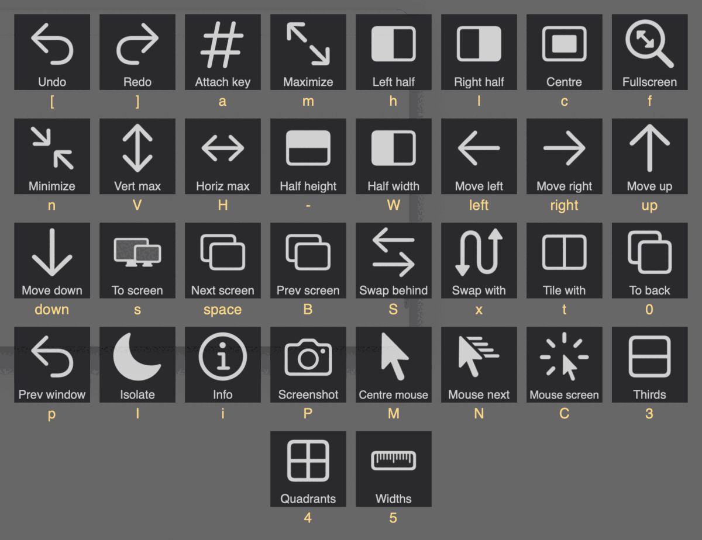
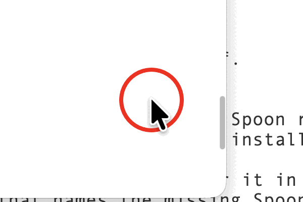
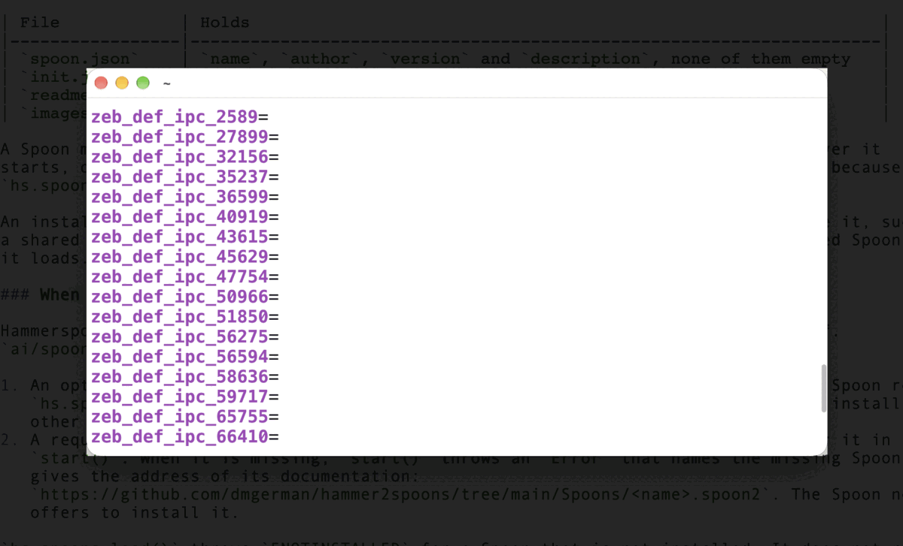

* hs_window-gt

hs_window-gt places, resizes and moves windows from the keyboard, and records every change so
that it can be undone.

- *Placement in a grid:* halves, thirds, two thirds, quadrants and the full screen, or any cell
  of a grid of any size.
- *Resizing in place:* full height, full width, half height, half width, or a fraction of the
  screen's width, keeping the window's position.
- *Undo and redo for each window,* including positions the window was given by hand between two
  commands.
- *Moving between screens:* to the next or previous screen, or to a screen chosen from a list,
  with the window keeping its place within the screen.
- *Two windows at once:* exchanging the positions of two windows, or placing them side by side.
- *Number keys:* a window can be attached to a digit, so that the digit with Option focuses it.
  The attachments are kept across a reload of Hammerspoon 2.
- *Isolation:* every part of every screen is dimmed except the focused window.
- *The pointer:* it can be moved to the middle of a window or of a screen.
- *A window menu,* opened with one key, in which a letter selects each option.

* Installing

The Spoon requires three other Spoons from this repository, which must be loaded before it:

- [[https://github.com/dmgerman/hammer2spoons/tree/main/Spoons/hs_interactive-gt.spoon2][hs_interactive-gt]]. Its choosers ask for the window or the screen that /Swap with/,
  /Tile with/ and /To screen/ act on.
- [[https://github.com/dmgerman/hammer2spoons/tree/main/Spoons/hs_windowfilter-gt.spoon2][hs_windowfilter-gt]]. Its events report when the focus moves to another window and when a
  window closes.
- [[https://github.com/dmgerman/hammer2spoons/tree/main/Spoons/hs_menu-gt.spoon2][hs_menu-gt]]. It displays the window menu.

The following configuration loads all four, and binds ⌥W to the window menu. The first time it
runs, Hammerspoon 2 downloads the four Spoons:

#+begin_src js
hs.spoons.use("hs_interactive-gt", { source: "dmgerman/hammer2spoons" })
hs.spoons.use("hs_windowfilter-gt", { source: "dmgerman/hammer2spoons" })
hs.spoons.use("hs_menu-gt", { source: "dmgerman/hammer2spoons" })
hs.spoons.use("hs_window-gt", {
    source: "dmgerman/hammer2spoons",
    start: true,
    hotkeys: { menuShow: [["alt"], "w"] }
})
#+end_src

When any of the three required Spoons is not loaded, =start()= throws an error that names the
missing one.

The =ref= option of =hs.spoons.use()= installs the Spoon from a particular tag or commit of the
repository instead of its main branch. =hs.spoons.update("hs_window-gt")= downloads the Spoon
again from the same source and ref, and reinstalls it when the version in its =spoon.json= has
changed. A Spoon installed from a tag or a commit is therefore never changed by an update.

** Requirements

The Spoon depends on the following:

- [[https://github.com/dmgerman/hammer2spoons/tree/main/Spoons/hs_interactive-gt.spoon2][hs_interactive-gt]], [[https://github.com/dmgerman/hammer2spoons/tree/main/Spoons/hs_windowfilter-gt.spoon2][hs_windowfilter-gt]] and [[https://github.com/dmgerman/hammer2spoons/tree/main/Spoons/hs_menu-gt.spoon2][hs_menu-gt]], loaded before this Spoon.
- The Accessibility permission, which Hammerspoon 2 requires to move any window.
- The Screen Recording permission, for =screenshot()= only.

* Binding keys

The =hotkeys= option of =hs.spoons.use()= binds a key to a function of the Spoon. Each function
is called without an argument, so it acts on the focused window. This example binds the window
menu, two halves, the full screen and undo:

#+begin_src js
hs.spoons.use("hs_window-gt", {
    source: "dmgerman/hammer2spoons",
    start: true,
    hotkeys: {
        menuShow:  [["alt"], "w"],
        leftHalf:  [["cmd", "ctrl", "alt"], "left"],
        rightHalf: [["cmd", "ctrl", "alt"], "right"],
        maximize:  [["cmd", "ctrl", "alt"], "up"],
        undo:      [["cmd", "ctrl", "alt"], "z"]
    }
})
#+end_src

No key is bound by default. A function called by a key receives no arguments, and reads each
one it needs as described under /Omitted arguments/: =fractionWidth=, for example, shows a
chooser of fractions. Two kinds of function cannot be bound:

1. Those whose arguments cannot be chosen from a list: =place=, =mouseMove= and =mouseHighlight=.
2. Those that only return a value, which a key cannot display: =historyDepth=, =isMaximized=,
   =isVerticallyMaximized=, =isHorizontallyMaximized=, =screenHasFullscreenWindow=,
   =fullscreenScreenIds=, =attachedWindows= and =isolationOn=. =start=, =stop= and
   =bindHotkeys= cannot be bound either.

A name that is not a function that can be bound is an error, and then no key is bound. A second
call to =bindHotkeys()= releases the keys of the first. =stop()= releases them as well.

* The window menu

The window menu holds every operation of the Spoon. =menuShow()= displays it on the screen of the
focused window. Each option has a letter beneath it, and pressing that letter selects the option.
The configuration under /Installing/ opens the menu with ⌥W.

#+ATTR_HTML: :alt The window menu: thirty-four options, such as Undo, Maximize, Left half, Next screen and Isolate, each with an icon and its letter

The menu accepts keyboard input only. Selecting an option closes the menu, with three exceptions:

1. Undo and Redo keep the menu open, so that they can be selected several times in a row.
2. Thirds, Quadrants and Widths open submenus, which stay open after an option is selected.
3. Swap with, Tile with and To screen close the menu, and then show a chooser of the other
   windows, or of the other screens.

hs_menu-gt waits half a second before drawing the menu. The letters are accepted during that
wait, so a letter pressed in time selects its option, and the menu is never drawn. The wait is
set in hs_menu-gt; 0 draws the menu at once:

#+begin_src js
hs.spoons["hs_menu-gt"].config.screen.showDelay = 0
#+end_src

The menu is also exported as =menu=, so another menu can include it as a submenu:

#+begin_src js
{ label: "Windows", key: "w", children: hs.spoons["hs_window-gt"].menu }
#+end_src

[[https://github.com/dmgerman/hammer2spoons/tree/main/Spoons/hs_menu-gt.spoon2][hs_menu-gt]] describes how menus are written.

* Functions

The functions are properties of the Spoon, =hs.spoons["hs_window-gt"]=. Every function that acts
on a window takes the window as its last argument:

#+begin_src js
const win = hs.spoons["hs_window-gt"]
win.leftHalf()             // the focused window
win.leftHalf(someWindow)   // a particular window
#+end_src

** Omitted arguments

In the signatures in this readme, an argument in brackets, such as =win= in =undo([win])=, may be
omitted. An argument that is omitted, or given as =undefined=, is read through hs_interactive-gt,
so every such function can be called without arguments from a key, a menu of the user's own, or
the console. An argument given as =null= is passed on unchanged.

| Argument                                 | Read as                                                     |
|------------------------------------------+-------------------------------------------------------------|
| the window                               | the focused window, or a window chosen in a chooser when no window is focused |
| a screen                                 | the focused window's screen, or the main screen when no window is focused |
| =denominator= of =fractionWidth=         | a fraction from 1/2 to 1/8, chosen in a chooser             |
| =direction= of =moveByOwnSize=           | left, right, up or down, chosen in a chooser                |
| =digit= of =digitAttach=                 | a digit from 0 to 9, chosen in a chooser                    |
| =digit= of =attachedFocus= and =keyDetach= | one of the digits attached to a window, chosen in a chooser that shows each window's title |

=windowToScreenMove=, =tileWith= and =windowWithWindowSwap= already show their own chooser for an
omitted screen or second window, and =keyToWindowAttach= waits for a digit to be pressed. A
function that shows a chooser returns a promise of its result, which is null when the chooser is
dismissed. A function that shows none returns its result directly.

Only the exported functions read omitted arguments. The window menu supplies every argument
itself.

** Return values

The functions that move or resize a window return =true= when the window was moved, and =false=
when it was not. A function returns =null= when a chooser for one of its arguments is dismissed,
and =false= without a message when the window's screen cannot be determined. For any other
refusal, such as a fullscreen window or a single screen, an alert gives the reason.

=undo=, =redo=, =historyClear=, =isolationStart=, =isolationStop=, =isolationToggle=, =start= and
=stop= return the Spoon. The other functions return the values described below.

** Undo

The Spoon keeps a history of positions for each window, and =undo= and =redo= move a window
through it. The history works as Emacs's winner-mode does, with one difference: it is kept per
window rather than per arrangement of windows.

The history of a window is a list of its earlier positions, oldest first, with at most
=config.historySize= entries. A position is added each time the Spoon moves the window. A
position identical to the last one in the list is not added again. When the list is full, the
oldest position is discarded.

An operation that moves two windows, such as =windowWithWindowSwap=, adds a position to each
window's history. Returning both windows takes one =undo= on each.

*** undo([win])

=undo= returns a window to its previous position. A second =undo= returns it to the position
before that, and so on: each call goes one position further back in the history. =undo= does not
remove positions from the history.

A move made by hand since the last command is also recorded. The first =undo= returns the window
to where it was left by hand, and the second to where the last command had put it.

*** redo([win])

=redo= returns a window to the position it had before the first of a series of =undo= calls. It
has an effect only immediately after =undo=. Any other move of the window ends the series.

*** historyDepth([win]), historyClear()

=historyDepth= returns the number of positions in a window's history. =historyClear= deletes the
history of every window. A window's history is also deleted when the window closes.

** Placing a window in a grid

These functions divide the screen into a grid and put the window in one or more of its cells.
They use the area of the screen that the menu bar and the Dock leave free.

*** place(win, grid, cell)

=place= divides the screen into =grid.cols= columns and =grid.rows= rows. It puts the window in
the cell at column =cell.col= and row =cell.row=, spanning =cell.colSpan= columns and
=cell.rowSpan= rows. The indices start at 0. A count that is omitted is 1, and an index that is
omitted is 0.

#+begin_src js
win.place(null, { cols: 3 }, { col: 1 })                                // the middle third
win.place(null, { cols: 4, rows: 2 }, { col: 2, row: 1, colSpan: 2 })  // the bottom right quarter
#+end_src

The named placements call =place=, and each takes an optional window, as in =leftHalf([win])=:
=leftHalf=, =rightHalf=, =topHalf=, =bottomHalf=, =leftThird=, =centerThird=, =rightThird=,
=leftTwoThirds=, =rightTwoThirds=, =topLeft=, =topRight=, =bottomLeft= and =bottomRight=.

=place= does not read omitted arguments. Its =win= may be =null=, as in the examples, for the
focused window, but =grid= and =cell= must be given.

*** maximize([win]), isMaximized([win])

=maximize= makes a window fill its screen. When the window already fills its screen, =maximize=
returns it to the size and position it had before the Spoon maximized it. A window that was made
to fill the screen by other means has no earlier size recorded, so =maximize= leaves it as it is
and an alert says so.

=isMaximized= returns whether a window fills its screen.

*** center([win])

=center= moves a window to the middle of its screen, without changing its size.

** Resizing in place

These functions change one dimension of a window, or move it by its own size. The other
dimension and the position stay as they are, except as each entry says.

| Function                      | Effect |
|-------------------------------+--------|
| =verticalMaximize([win])=     | Makes the window as tall as the screen, keeping its width and horizontal position. When it is already that tall, returns it to the height and vertical position it had before. |
| =horizontalMaximize([win])=   | Makes the window as wide as the screen, keeping its height and vertical position. When it is already that wide, returns it to the width and horizontal position it had before. |
| =halfHeight([win])=           | Halves the window's height. The top edge stays in place. |
| =halfWidth([win])=            | Halves the window's width. The left edge stays in place. |
| =fractionWidth([denominator], [win])= | Sets the window's width to =1/denominator= of the screen's width. =denominator= is a number of at least 1. |
| =moveByOwnSize([direction], [win])= | Moves the window by its own width or height, without resizing it. =direction= is ="left"=, ="right"=, ="up"= or ="down"=. |

=moveByOwnSize= reports any other direction in an alert, and does not move the window.
=isVerticallyMaximized([win])= and =isHorizontallyMaximized([win])= return whether a window is as tall
or as wide as its screen.

** Screens

These functions move a window to another screen, and report which screens are showing a
fullscreen window.

*** windowToScreenMove([target], [win])

=windowToScreenMove= moves a window to another screen. =target= is one of the following:

- ="next"= or ="previous"=, the screen after or before the window's screen, in the order of
  =hs.screen.all()=. Screens showing a fullscreen window are skipped, because a window moved
  there would be hidden behind the fullscreen window.
- A screen object. The move is refused when that screen is showing a fullscreen window.
- Nothing. A chooser lists the other screens, and the function returns a promise of whether the
  window was moved.

The window keeps its relative position and size within the screen. A window that returns to a
screen it was on before goes back to the position it had there. That position is not used when
the window has been moved or resized by other means since the Spoon last moved it.

*** fullscreenScreenIds(), screenHasFullscreenWindow([screen])

=fullscreenScreenIds= returns a =Set= of the ids of the screens that are showing a fullscreen
window. =screenHasFullscreenWindow= returns whether one screen is among them.

** Two windows, and the focus

These functions act on two windows at once, or change which window has the focus.

*** tileWith([other], [win])

=tileWith= places two windows side by side on the screen of =win=: =other= on the left half, and
=win= on the right half. Both windows are brought to the front, and =win= keeps the focus. When
=other= is omitted, a chooser lists the other windows, and the function returns a promise.

*** windowWithWindowSwap([other], [win]), windowWithPreviousSwap([win])

=windowWithWindowSwap= exchanges the positions and sizes of two windows. The two windows can be
on the same screen or on different screens. When =other= is omitted, a chooser lists the other
windows, and the function returns a promise.

=windowWithPreviousSwap= exchanges a window with the frontmost of the other windows. When =win=
is the focused window, that is the window directly behind it.

*** windowPrevious()

=windowPrevious= focuses the window that had the focus before the focused window. That window may
belong to the same application. When no previous window is known, or it has closed, the window
directly behind the focused window is focused instead.

*** windowToBackSend([win])

=windowToBackSend= puts a window behind all the others. macOS has no operation that lowers a
window, so the Spoon focuses every other window, in reverse order, which leaves this window
last.

*** windowFocus([win])

=windowFocus= focuses a window, brings its application to the front, and returns whether the
window accepted the focus. It is more reliable than =win.focus()= alone, for the reason given
under /Notes/.

** Windows attached to number keys

A window can be attached to a digit. From then on, the digit pressed with
=config.attachModifiers=, which is Option by default, focuses that window from any application.
When that window already has the focus, the same key focuses the window that had the focus
before it, as =windowPrevious= does.

| Function                        | Effect |
|---------------------------------+--------|
| =keyToWindowAttach([win], [key])= | Attaches a window to a digit. When =key= is omitted, the next key pressed is used. Escape, or no key within =config.attachKeyWait= seconds, cancels. A key that is not a digit is refused with an alert. |
| =digitAttach([win], [digit])=   | Attaches a window to a digit given as a string. A digit already in use is released first. Returns whether the window was attached. |
| =attachedFocus([digit])=        | Focuses the window attached to a digit. This is what the digit's key calls. |
| =keyDetach([digit])=            | Releases a digit. |
| =keysAllDetach()=               | Releases every digit. |
| =attachedWindows()=             | Lists the attachments, to check them in the console. It returns an object that maps each digit to its window's =title=, =id=, =bundleID=, whether it still exists (=alive=), and its current title (=nowTitled=) and application (=nowBundleID=). |

A digit is released when its window closes. When an application quits without closing its
windows, the digit is released the next time its key is pressed.

The attachments are saved in =config.attachFile=. =start()= reads that file, and attaches the
same windows again after Hammerspoon 2 is reloaded. Window ids change when an application is
quit and opened again, and when the computer restarts. In that case a digit is attached to a
window of the same application with the same title, if there is one. An alert lists the digits
that were attached again, and the digits whose window was not found.

** The pointer

These functions move the mouse pointer. Each draws a circle around the pointer's new position
for =config.mouseHighlightSeconds=, so that the pointer can be found after it has moved a long
distance at once.

| Function                      | Effect |
|-------------------------------+--------|
| =mouseWindowCenter([win])=    | Moves the pointer to the middle of a window. |
| =mouseWindowCenterNext()=     | Moves the pointer to the middle of the next window. Each call moves it to the window after the last one. |
| =mouseScreenCenter([screen])= | Moves the pointer to the middle of a screen. |
| =mouseScreenCenterNext()=     | Moves the pointer to the middle of the screen after the one it is on, in the order of =hs.screen.all()=. |
| =mouseMove(x, y)=             | Moves the pointer to a point in screen coordinates. |
| =mouseHighlight(x, y)=        | Draws the circle around a point, without moving the pointer. |

#+ATTR_HTML: :alt The mouse pointer inside a red ring

=mouseWindowCenterNext= takes the standard windows that are on screen, in the order in which
hs_windowfilter-gt first saw them. The first call starts at the window after the focused one.
When a window opens or closes, the next call starts again from the window after the focused one.

The middle of a screen is the middle of the whole display, including the area of the menu bar
and the Dock.

** Isolation

Isolation dims everything except the focused window. =isolationStart()= turns it on,
=isolationStop()= turns it off, =isolationToggle()= changes from one to the other, and
=isolationOn()= returns whether it is on.

In this example, the Terminal window in front has the focus and is not dimmed, and the window
behind it is dimmed:

#+ATTR_HTML: :alt A Terminal window shown normally in front of a dimmed window of text

While isolation is on, the area that is not dimmed follows the focused window, on any screen. It
also changes when that window is moved or resized. The area is the window's frame, not the
display it is on. A window that covers part of a screen leaves the rest of that screen dimmed. A
fullscreen window covers the whole display, so that display is not dimmed at all, and every other
display is.

** Information about a window

Two functions read a window without changing it. =info()= displays the window's
application, title, screen and frame, and =screenshot()= saves an image of the window.

*** info([win])

=info()= displays the facts about a window that a configuration refers to: its application's name
and bundle identifier, its title, its screen, its position and size, and how many positions its
undo history holds. It is used, for example, to find the bundle identifier to give
=hs.application.matchingBundleID()=, or to check the frame a placement produced. Without an
argument, it reports the focused window.

The facts are shown in an alert for four seconds and written to the console.

*** screenshot([win])

=screenshot= captures a window, copies the image to the pasteboard, and writes it as a PNG file
to =config.screenshotDir=. The file is named after the time and the application. The function
returns a promise of the file's path, or of =null= when nothing was captured. It requires the
Screen Recording permission.

** start() and stop()

=start()= checks that hs_interactive-gt, hs_windowfilter-gt and hs_menu-gt are loaded, subscribes to
hs_windowfilter-gt's events, and attaches the windows saved in =config.attachFile= again.

=stop()= releases the keys bound by =bindHotkeys()=, turns isolation off, removes the circle
around the pointer, and unsubscribes from hs_windowfilter-gt. It also releases the number keys.
It does not remove them from =config.attachFile=, so the next =start()= attaches them again.

* Configuration

The settings are properties of =config=, and can be changed after the Spoon is loaded:

#+begin_src js
const win = hs.spoons["hs_window-gt"]
win.config.isolationOpacity = 0.7
win.config.mouseHighlightColor = "#00FF00"
#+end_src

| Setting                  | Default     | Meaning |
|--------------------------+-------------+---------|
| =historySize=            | =200=       | The number of positions kept in each window's history. The oldest is discarded first. |
| =isolationColor=         | ="#000000"= | The colour of the panels that dim the screens during isolation. |
| =isolationOpacity=       | =0.85=      | The opacity of those panels, from 0.0 to 1.0. |
| =mouseHighlightColor=    | ="#FF0000"= | The colour of the circle drawn around the pointer. |
| =mouseHighlightSize=     | =60=        | The diameter of the circle, in pixels. |
| =mouseHighlightWidth=    | =4=         | The width of the circle's line, in pixels. |
| =mouseHighlightSeconds=  | =0.5=       | The number of seconds the circle is displayed. |
| =screenshotDir=          | ="/tmp"=    | The directory =screenshot()= writes to. |
| =screenshotAlertSeconds= | =3=         | The number of seconds the path of a capture is displayed. |
| =attachModifiers=        | =["alt"]=   | The modifiers pressed with a digit to focus its window. |
| =attachKeys=             | ="123456789"= | The digits a window can be attached to. |
| =attachKeyWait=          | =5=         | The number of seconds =keyToWindowAttach()= waits for a digit when none is given. |
| =attachFile=             | =logs/window-keys.json= in the configuration directory | The file the attachments are saved in. |
| =focusReassertDelay=     | =0.3=       | The number of seconds after which =windowFocus()= makes the window its application's main window again. 0 turns this off. See /Notes/. |

* Commands for hs_interactive-gt

This Spoon requires [[https://github.com/dmgerman/hammer2spoons/tree/main/Spoons/hs_interactive-gt.spoon2][hs_interactive-gt]] for its choosers. hs_interactive-gt can also give
each function of the Spoon a command name, so that the function can be run from the command
chooser and bound to a key by name.
The following definitions name each command after the function it calls:

#+begin_src js
interactive.use("hs_window-gt", {
    commands: (interactive, win) => {
        const onWindow = (name, doc, fn) => interactive.define({
            name: name,
            doc: doc,
            interactive: [{ name: "window", reader: interactive.readers.window.auto }],
            fn: fn
        })

        onWindow("window-maximize", "Fill the screen with a window.", (w) => win.maximize(w))
        onWindow("window-left-half", "Move a window to the left half of its screen.", (w) => win.leftHalf(w))
        onWindow("window-right-half", "Move a window to the right half of its screen.", (w) => win.rightHalf(w))
        onWindow("window-to-screen-move-next", "Move a window to the next screen.", (w) => win.windowToScreenMove("next", w))
        onWindow("window-with-previous-swap", "Swap a window with the window behind it.", (w) => win.windowWithPreviousSwap(w))
        onWindow("key-to-window-attach", "Attach a window to a number key.", (w) => win.keyToWindowAttach(w))

        interactive.define({ name: "window-undo", doc: "Put a window back where it was.", fn: () => win.undo() })
        interactive.define({ name: "window-previous", doc: "Focus the previous window.", fn: () => win.windowPrevious() })
        interactive.define({ name: "window-menu-show", doc: "Show the window menu.", fn: () => win.menuShow() })
    },
    keys: [
        [["alt"], "m", "window-maximize"],
        [["alt"], "w", "window-menu-show"]
    ]
})
#+end_src

A command's name is its function's name in hyphenated words. It begins with =window-= when the
function's name does not already name what it acts on.

* Notes

These notes explain behaviour that follows from macOS or from Hammerspoon 2, rather than from
the Spoon's design.

- *What undo records.* The Spoon records every move it makes. It does not observe a window being
  moved by hand or by other code. Before it next changes a window, it compares the window's
  position with the position it last gave the window. When the two differ, it adds both to the
  history.
- *The overlays do not receive clicks.* The dimming panels and the circle around the pointer are
  =hs.canvas= windows created with =ignoreMouseEvents(true)=, so a click reaches the window
  underneath them. They are also created with =canJoinAllSpaces=, which displays them over a
  fullscreen window's Space.
- *Fullscreen windows are refused.* macOS refuses to move a fullscreen window. A window moved to
  a screen that is showing a fullscreen window is placed in that window's Space, and then neither
  =hs.window.allWindows()= nor its own application lists it. The Spoon therefore refuses any
  operation involving a fullscreen window, or a screen showing one, and an alert says so.
- *How a fullscreen screen is detected.* Hammerspoon 2 has no module for Spaces, and
  =hs.window.allWindows()= includes windows on Spaces that are not displayed. The Spoon therefore
  takes the window at the centre of each screen, and checks whether it is fullscreen.
- *windowFocus() makes the window main twice.* After =focus()= returns, an application can make a
  different one of its windows its main window while it processes the activation, which brings
  that other window to the front. The Spoon therefore makes the window main and raises it again
  after =config.focusReassertDelay=. This remains until Hammerspoon 2's =focus()= does the same
  for every application. It already does so for Finder.
- *windowToBackSend() focuses every other window.* Each of their applications is activated in
  turn.
- *There is no hs.window.highlight* in Hammerspoon 2. Hammerspoon 1's isolation used it, so this
  Spoon draws the dimming with =hs.canvas=.
