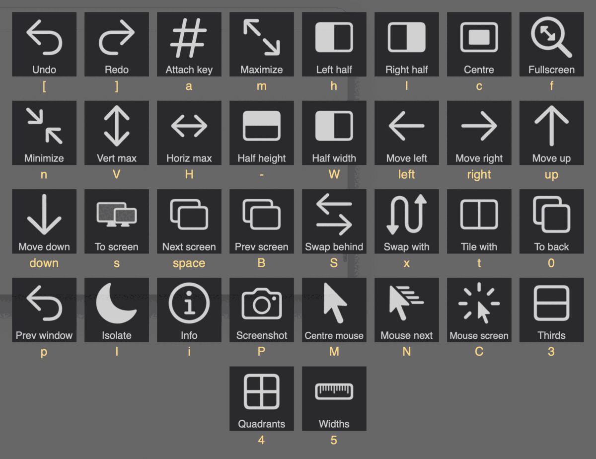

#+TITLE: hammer2spoons

A collection of Spoons for [[https://github.com/cmsj/Hammerspoon2][Hammerspoon 2]], for managing windows, switching between them,
controlling Apple Music, and operating all of these from the keyboard.

- Windows are placed, resized and moved between screens with single keys, and every change can
  be undone.
- A window is selected by typing part of its title or its application's name, with the most
  recently used windows listed first.
- Each Spoon that performs actions provides an on-screen menu of them, in which a letter selects
  each option.
- Apple Music is controlled from a menu, and albums are played from a list kept in a text file.
- Every Spoon is installed and updated from this repository with =hs.spoons.use()=.

#+ATTR_HTML: :alt The window menu of hs_window-gt: thirty-four options, each with an icon and the letter that selects it

The window menu of [[https://github.com/dmgerman/hammer2spoons/tree/main/Spoons/hs_window-gt.spoon2][hs_window-gt]].

* The Spoons

The table lists each Spoon, what it does, and the other Spoons it requires. A required Spoon
must be loaded before the Spoon that requires it.

| Spoon                | What it does                                                                         | Requires                       |
|----------------------+--------------------------------------------------------------------------------------+--------------------------------|
| [[https://github.com/dmgerman/hammer2spoons/tree/main/Spoons/hs_window-gt.spoon2][hs_window-gt]]       | Places, resizes and moves windows from the keyboard, with undo, either directly or from a menu in which a letter selects each option. Attaches windows to number keys, and dims every window except the focused one. | hs_interactive-gt, hs_windowfilter-gt, hs_menu-gt |
| [[https://github.com/dmgerman/hammer2spoons/tree/main/Spoons/hs_selectWindow-gt.spoon2][hs_selectWindow-gt]] | Selects a window by part of its title, with the most recently used first, and switches between two applications with one key for each. | hs_interactive-gt, hs_windowfilter-gt, hs_window-gt |
| [[https://github.com/dmgerman/hammer2spoons/tree/main/Spoons/hs_appleMusic-gt.spoon2][hs_appleMusic-gt]]   | Controls Apple Music from a menu in which a letter selects each option, and plays albums from a list in a text file, chosen by name or at random. | hs_interactive-gt, hs_menu-gt  |
| [[https://github.com/dmgerman/hammer2spoons/tree/main/Spoons/hs_menu-gt.spoon2][hs_menu-gt]]         | Displays menus of options on screen, operated from the keyboard only: a letter selects each option. The same menus can be displayed on a Stream Deck. |                    |
| [[https://github.com/dmgerman/hammer2spoons/tree/main/Spoons/hs_interactive-gt.spoon2][hs_interactive-gt]]  | Defines named commands, runs them from a chooser by name, and binds keys to them by name, in the manner of Emacs's =M-x=. Provides the readers through which other Spoons ask for a window, a screen or other input. |              |
| [[https://github.com/dmgerman/hammer2spoons/tree/main/Spoons/hs_windowfilter-gt.spoon2][hs_windowfilter-gt]] | Reports window events, filtered by rules, in the manner of Hammerspoon 1's =hs.window.filter=. |                                |

A Spoon that asks for input, such as a window or a screen, requires hs_interactive-gt and uses
its choosers. A function of any Spoon can also be made a named command of hs_interactive-gt in
the configuration.

* Installing

Each Spoon is installed with =hs.spoons.use()=, given this repository as its source. The
example installs hs_window-gt, preceded by the three Spoons it requires, and binds ⌥W to its
menu:

#+begin_src js
hs.spoons.use("hs_interactive-gt", { source: "dmgerman/hammer2spoons" })
hs.spoons.use("hs_windowfilter-gt", { source: "dmgerman/hammer2spoons" })
hs.spoons.use("hs_menu-gt", { source: "dmgerman/hammer2spoons" })
hs.spoons.use("hs_window-gt", {
    source: "dmgerman/hammer2spoons",
    start: true,
    hotkeys: { menuShow: [["alt"], "w"] }
})
#+end_src

The =ref= option of =hs.spoons.use()= installs a Spoon from a particular tag or commit of the
repository instead of its main branch. =hs.spoons.update(name)= downloads a Spoon again from
the same source and ref, and reinstalls it when the version in its =spoon.json= has changed. A
Spoon installed from a tag or a commit is therefore never changed by an update.

Each Spoon's readme gives the installation of that Spoon.

* Requirements

The Spoons require a build of Hammerspoon 2 from its main branch on 2026-11-02 or later.
Release 0.0.16 and earlier cannot install Spoons from a repository, and do not have
=hs.spoons.load()=.
